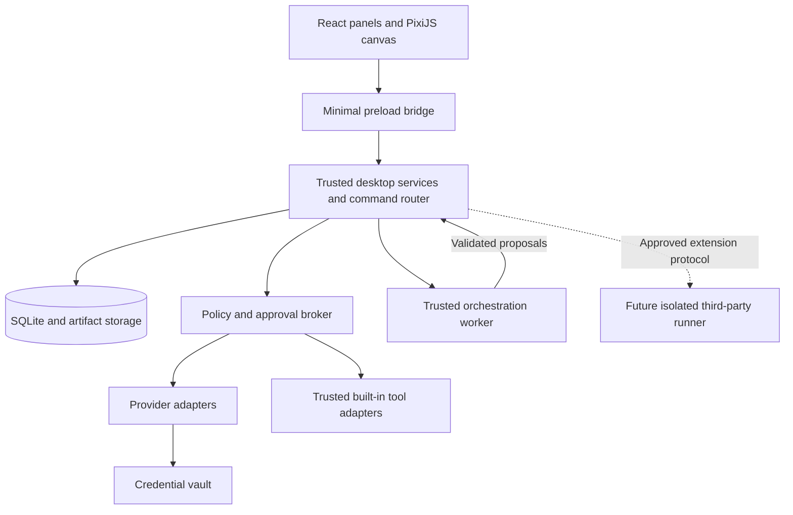

# Technical Architecture

> **Source:** Atlas Realm Build Plan rev 1.1, §7, §8, §16 — copied verbatim from [the archived original](../archive/Atlas_Realm_Build_Plan_v1.1.md). Section numbers are kept so cross-references like "see section 33" still work. Edit this file (not the archive) when the spec changes, and record why in an ADR.

## 7. Recommended technical architecture

### 7.1 Stack decision

| Layer | Recommended default | Reason and boundary |
|---|---|---|
| Desktop shell | Electron | Windows desktop integration and a TypeScript-friendly implementation |
| Interface | React + TypeScript + Vite | Conventional forms and component-based UI |
| World/interior renderer | PixiJS | 2D exteriors and 2.5D cutaway/Blueprint views inside the normal application |
| Relationship interface | React Flow, evaluated with a small layout spike | Nodes, typed edges, grouped graphs, focus view, and accessible companion lists |
| Index and import services | Trusted bounded local parsers and SQLite projections | Permission-scoped inspection and incremental relationships; no separate graph database |
| Obsidian bridge | Local Markdown/JSON Canvas exporter and validated URI opener | Optional initial export/open integration, independent of core execution |
| Asset production | PixelLab remote MCP through the builder's supported client | Development-time generation; package reviewed local files for offline runtime |
| Shared validation | Zod or equivalent | Validate IPC, manifests, configuration, and model-produced structured proposals |
| Persistence | SQLite with versioned migrations | Embedded local data; no database server needed |
| Database access | One selected maintained SQLite binding, wrapped in repositories | Verify Electron packaging compatibility before committing |
| Workflow engine | Small explicit persisted state machine | Keep first workflows bounded and understandable |
| Local inference | Ollama adapter | Optional installed local model runtime |
| Cloud inference | Official provider SDKs behind adapters | Keep provider-specific behavior out of workflow logic |
| Scheduling | Persistent SQLite schedule/queue plus application worker | In-process timers wake work; persisted records determine what is due |
| Secrets | OS-protected secret storage through a narrow vault interface | Never store keys in renderer state or ordinary settings |
| Tests | Vitest plus supported Electron end-to-end tooling | Domain, persistence, security, and actual packaged behavior |
| Packaging | One maintained Electron packaging toolchain | Windows package first; prove native dependencies and assets work |

This is a recommended design, not a claim that the frameworks provide all required safeguards. Electron's own guidance emphasizes the additional privileges and security obligations of a desktop application. [Electron security guidance](https://www.electronjs.org/docs/latest/tutorial/security).

PixiJS provides the visual rendering layer. It is not the source of project state or the workflow scheduler. [PixiJS introduction](https://pixijs.com/8.x/guides/getting-started/intro).

PixiJS owns visual scenes, React Flow owns relationship diagrams, and shared domain IDs plus committed events keep selection consistent. Do not create separate authoritative file/project models for each view. Detailed additions are in sections 30–34.

Keep a runtime interface so a framework such as LangGraph can be evaluated later if branching and persistent orchestration become difficult. Do not combine several orchestration engines in the first release.

### 7.2 Process boundaries



- **Renderer:** No direct Node, filesystem, shell, database, or credential access. It sends typed commands and renders sanitized responses/events.
- **Preload:** Exposes a small explicit API. No generic arbitrary IPC forwarding or command evaluation.
- **Trusted desktop services:** Own database writes, the vault, file operations, policy checks, provider calls, and event publication. Keep CPU-heavy work off the UI/main thread.
- **Orchestration worker:** Runs trusted application workflow code, receives bounded context, and proposes model/tool operations through the broker. It is not a security sandbox and must not load community code.
- **Third-party runner:** A separate future component with OS-enforced restrictions. It cannot be replaced by merely creating another Node process.

Use authenticated internal process messaging with schema validation, sender checks, bounded message sizes, request IDs, and cancellation. Do not expose an unauthenticated localhost control server for convenience.

### 7.3 Dependency direction

`UI → commands/queries → application services → domain policies → repository/adapter interfaces`

The domain layer must not import React, PixiJS, Electron UI objects, or a particular provider SDK. Provider calls and tool execution must pass policy evaluation immediately before dispatch.

### 7.4 Local runtime lifecycle

- Enforce a single active application instance per profile data set.
- Window Close offers clear behavior: quit, or remain in tray with the runner active.
- First release need not install an operating-system service or start automatically at login.
- Full Quit stops accepting jobs, checkpoints safe state, requests cancellation, and reports in-flight uncertain effects on next startup.
- UI reload/reconnect reads snapshots and event cursors; it never restarts a workflow by itself.
- User logout/profile switching cannot leave the old profile's secret-bearing runs executing unnoticed. Stop or explicitly keep the profile runner visible; default to stop and checkpoint.

## 8. Suggested repository structure

Start with one TypeScript application. Avoid a complex monorepo until package ownership is actually useful.

```text
atlas-realm/
  CLAUDE.md
  README.md
  package.json
  pnpm-lock.yaml
  tsconfig.json
  src/
    common/
      contracts/          # Command, query, event, and adapter schemas
      errors/             # Stable machine codes and user-safe error shapes
      ids/                # Stable identifiers
    domain/
      worlds/
      projects/
      resources/
      agents/
      workflows/
      graph/
      imports/
      obsidian/
      permissions/
      scheduling/
    main/
      bootstrap/
      ipc/
      services/
      indexing/
      imports/
      obsidian/
      storage/
        migrations/
        repositories/
      vault/
      providers/
        mock/
        ollama/
        anthropic/
        openai/
      tools/
        builtin/
      runtime-bridge/
      packaging/
    worker/
      execution/
      scheduling/
    preload/
    renderer/
      app/
      components/
      screens/
      world/
      interiors/
      atlas/
      editors/
      state/
  resources/
    assets/
      fantasy/
      interiors/
      atlas-icons/
      asset-manifest.json
    agent-templates/
    skills/
    project-templates/
    tool-manifests/
  tests/
    fixtures/
    domain/
    integration/
    security/
    e2e/
  docs/
    PRODUCT_RULES.md
    ARCHITECTURE.md
    IMPLEMENTATION_STATUS.md
    DECISIONS.md
    THREAT_MODEL.md
    TEST_PLAN.md
    ART_BIBLE.md
    GRAPH_MODEL.md
    IMPORT_SPEC.md
    OBSIDIAN_BRIDGE.md
    ASSET_PROVENANCE.md
```

The suggested folders are logical boundaries. Claude can adapt naming to an existing repository without changing the product rules.

## 16. Events, IPC, and observable progress

### 16.1 Command/query examples

| Contract | Essential input | Result |
|---|---|---|
| `world.create` | Name, theme | World summary |
| `project.create` | World, template version, goal | Saved project ID and summary |
| `building.place` | Project ID, world, grid coordinates, rotation | Valid placement or reason |
| `hotbar.pin` | World, slot, target | Updated slot |
| `agent.recruit` | Project, template/version, overrides | Agent instance and readiness |
| `resource.install` | Staged package reference | Validation/install report |
| `provider.connection.create` | Provider config plus separate secret input | Connection ID; never raw secret |
| `run.start` | Project, workflow version, bindings, limits | Run ID |
| `run.cancel` | Run ID | Cancellation state and outstanding effects |
| `approval.decide` | Approval ID, decision | Updated request/run status |
| `automation.create` | Definition and reviewed preview | Saved automation |
| `artifact.open` | Artifact ID/revision | Safe preview or user-requested OS open |
| `world.export` | World ID, selected destination | Backup result and manifest summary |
| `atlas.query` | Authorized world/project/focus, filters, bounded depth/cursor | Permission-filtered nodes/edges and freshness |
| `graph.relation.propose` | Entity IDs, relation type, evidence/source | Reviewed proposal; no automatic workflow action |
| `graph.layout.save` | View scope and positions | Cosmetic layout revision |
| `project.interior.open` | Project ID and presentation mode | Authorized station/layout context |
| `project.import.inspect` | User-selected root, limits, exclusions | Inventory and setup proposal; no source mutation |
| `project.import.commit` | Reviewed session/proposal revision and mode | Saved project, mappings, and initial graph |
| `obsidian.export` | Enabled binding, selected entities, preview revision | Files written within the approved subfolder and export receipt |
| `obsidian.disable` | Binding ID and scope | Watchers/queued transfers stopped; existing files preserved |

Validate the sender, command schema, target ownership, policy, and expected revision. Renderer-supplied paths and IDs are untrusted inputs. Queries are paginated, bounded, and scoped to the active profile/world as appropriate.

Expected failures return stable domain codes (`not_found`, `already_exists`, `revision_conflict` with the current revision, `invalid_transition`, `limit_reached`) next to the router's own codes; an ID from another profile is reported as `not_found`. (Changed by ADR-0019.)

Project commands name the world as well as the project; a project outside that world is `not_found`. `project.list` pages with an opaque keyset cursor (default 50, max 100). (Changed by ADR-0020.)

### 16.2 Event envelope

```ts
interface AppEvent<TPayload> {
  sequence: number;
  schemaVersion: number;
  type: string;
  occurredAt: string;
  worldId?: string;
  projectId?: string;
  runId?: string;
  correlationId: string;
  payload: TPayload;
}
```

Examples: `project.created`, `building.placed`, `run.queued`, `step.started`, `approval.requested`, `artifact.committed`, `run.interrupted`, `run.completed`, `automation.occurrence.skipped`, `graph.index.updated`, `graph.relation.confirmed`, `interior.station.selected`, `project.import.committed`, `obsidian.export.completed`, `obsidian.binding.disabled`. Cosmetic pointer movement is ephemeral; significant index/export/import outcomes are durable.

Persist authoritative state and durable events before broadcasting them. The canvas and panels subscribe to the same committed events. On reconnect, load a current snapshot and continue from a cursor without gaps. At-least-once delivery is acceptable when consumers deduplicate by sequence.

Token streaming can use ephemeral progress messages with bounded buffering; do not insert every token as a durable database row. A dropped stream does not mean the run stopped.
