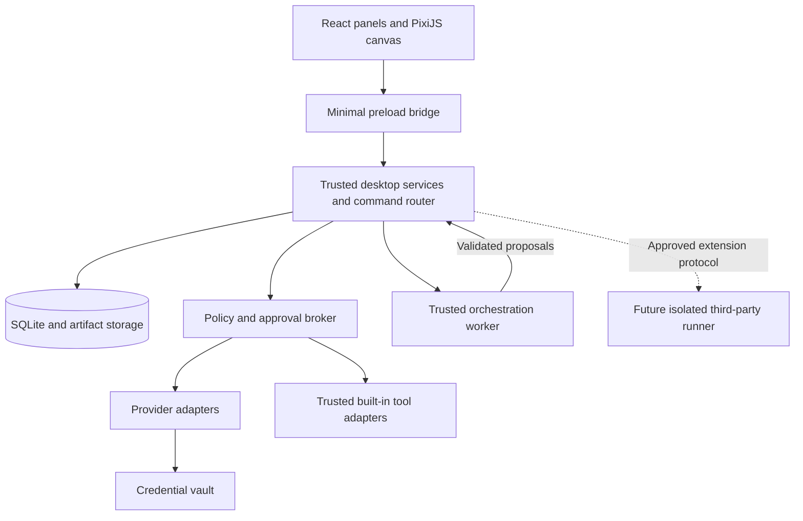

# Atlas Realm: An Agentic AI Ecosystem

**App name:** Atlas Realm.
**Full title:** Atlas Realm: An Agentic AI Ecosystem.
**Document:** Product and implementation plan, revision 1.1.
**Prepared:** November 5, 2026.
**Updated:** November 6, 2026.
**Approved direction:** Fantasy RPG art; a context-sensitive upper-right Realm Atlas; enterable 2.5D interiors with Blueprint mode; optional Obsidian export/open first; reviewed automatic project imports; PixelLab MCP as the preferred asset-production route.
**Purpose:** A detailed specification and incremental implementation guide for building this application with Claude.
**Status:** Proposed design; no application has been implemented by this document.
**Initial platform:** Windows desktop. Keep boundaries portable for later macOS and Linux support.

**Start here:** Give Claude this file, use the [master project prompt](#271-master-project-prompt), and begin with [M0](#m0--foundation-and-risk-spikes). Keep this document in the eventual application repository as the product/build specification.

### Quick navigation

- [Product vision and boundaries](#2-product-vision-and-boundaries)
- [MVP and later release scope](#4-release-scope)
- [Interface and world controls](#6-interface-and-interaction-specification)
- [Architecture and stack](#7-recommended-technical-architecture)
- [Storage and data model](#9-data-ownership-storage-and-schema)
- [AI provider connections](#11-ai-model-connections-and-provider-adapters)
- [Workflow execution and recovery](#12-workflow-execution-and-multi-agent-coordination)
- [Permissions and approvals](#13-permission-and-approval-model)
- [Automations and scheduling](#15-automations-and-scheduling)
- [Verification strategy](#22-verification-strategy)
- [Milestone roadmap](#23-milestone-implementation-roadmap)
- [Copy-ready Claude prompts](#27-copy-ready-prompts-for-claude)
- [Final implementation checklist](#29-final-implementation-checklist)
- [Realm Atlas and relationship graphs](#30-realm-atlas-and-relationship-graphs)
- [Enterable interiors and Blueprint mode](#31-enterable-interiors-and-blueprint-mode)
- [Optional Obsidian bridge](#32-optional-obsidian-bridge)
- [Import Existing Project wizard](#33-import-existing-project-wizard)
- [Fantasy art direction and PixelLab asset pipeline](#34-fantasy-art-direction-and-pixellab-asset-pipeline)

---

## 1. How to use this plan with Claude

Give Claude this entire file as project context. Use the master prompt in section 27, then ask it to implement one milestone at a time. Do not ask for the entire ecosystem in a single generation.

This document distinguishes three kinds of decisions:

- **Requirement:** A behavior that preserves the user's stated concept or protects data and execution correctness.
- **Recommended default:** A concrete implementation choice that can be changed with an explanation in the decision log.
- **Later expansion:** A capability deliberately excluded from the first usable release.

Before implementation, Claude should inspect the actual repository, identify existing conventions, verify current dependency compatibility, and record selected versions. Official API examples and authentication requirements can change; this document does not freeze model names, prices, or SDK versions.

For each milestone, Claude should:

1. Read the relevant sections and inspect existing code.
2. Identify a small, reviewable implementation slice and its acceptance criteria.
3. Implement the slice without replacing unrelated working functionality.
4. Run relevant automated checks and the milestone's manual acceptance steps.
5. Update `docs/IMPLEMENTATION_STATUS.md` with what works, evidence, limitations, and the next task.
6. Report actual behavior. Label mock providers, placeholders, and unsupported integrations explicitly.

The first milestone must not require a paid API account. The world, persistence, and execution tests should work with a deterministic mock provider. Real AI functionality is added later and must be tested separately from mock execution.

## 2. Product vision and boundaries

### 2.1 Product promise

A beginner-friendly desktop application where users organize projects as buildings in a fantasy RPG world, enter 2.5D isometric project interiors, inspect connections through a context-sensitive Realm Atlas, assign AI agents and capabilities, supervise work, and reuse workflows as automations. Users can import existing projects, and optionally exchange selected knowledge with Obsidian.

The application should support multiple fields through configurable project packages: personal planning, organizations, marketing, school work, social media, software, and custom projects. Supporting a field means delivering useful, evaluated workflows for that field. It does not mean claiming reliable autonomous execution of every possible task.

### 2.2 Core requirements

1. The application opens and manages local projects without internet access.
2. Users retain access to their files and deliverables without an active cloud account.
3. Each world is a workspace; each project can have a building representation.
4. Ten hotbar slots provide shortcuts and placement access, without limiting project count.
5. A larger library opens through a visible button or `E` when keyboard focus permits.
6. Agents Guild, Skill Library, and Tool Shops have sidebar access and optional world structures.
7. Installed resources remain manageable offline; discovery and downloads require connectivity.
8. Agents can execute bounded tasks and participate in saved workflows.
9. Automations can start those workflows from supported triggers.
10. File access, external actions, provider use, and executable integrations are permission-controlled.
11. AI providers and local model runtimes are interchangeable through explicit adapters.
12. The world shows actual execution state. Cosmetic animations must not imply nonexistent work.
13. Users can operate projects through ordinary accessible controls without moving an avatar.
14. Completed work survives UI closure, application restart, and recoverable interruption.
15. An upper-right Realm Atlas switches between a geographic Map and a contextual Connections graph.
16. Project buildings have an enterable 2.5D cutaway interior and a Blueprint mode; true rotatable 3D is deferred.
17. Project/file/task relationships have explicit types, provenance, and permission-aware visibility.
18. Import Existing Project inspects supported files and proposes a setup for review before committing changes.
19. Obsidian is optional and disabled by default; initial support is selected Markdown/Canvas export and opening notes.
20. Fantasy pixel assets are bundled for offline display; PixelLab generation is an optional online production step.

### 2.3 Recommended initial constraints

- Single user on one computer; local profiles are a convenience boundary, not separate operating-system security identities.
- Local-first data ownership. Cloud synchronization and organization collaboration come later.
- One active model request by default; several logical agents may execute sequentially.
- A maximum initial team of three agents per workflow: coordinator, specialist, reviewer.
- Trusted built-in file tools before third-party executable integrations.
- User-supplied provider credentials; no shared developer API key distributed in the app.
- A modest fantasy world with a finite buildable area and simple placement.
- A 2D/2.5D renderer for both exteriors and interiors; no new real-time 3D engine in the MVP.
- One SQLite-backed relationship model shared by the Atlas panel, project graph, import index, and Obsidian exporter.
- Deterministic folder analysis before optional AI setup suggestions; no silent modification of imported originals.
- No game economy, multiplayer game networking, combat, resource grinding, or pay-to-unlock work capacity.

### 2.4 Explicit limits of an offline desktop system

- A cloud model needs internet even when the interface and files are local.
- A local model needs downloaded weights, compatible software, sufficient memory, and task-appropriate capability.
- A connected online service cannot be used offline merely because its connector is installed.
- A local automation cannot run while the computer is powered off or asleep.
- Always-on business execution needs an awake dedicated machine or a future remote runner.
- Multiple buildings do not imply multiple secure tenants. Business deployment requires additional isolation and administration.
- Generating new assets through PixelLab requires its online service and an eligible account; showing already bundled assets does not.
- Obsidian file export/open can work locally when its prerequisites are installed; cloud sync is a separate service and is not required.

## 3. Product vocabulary and world rules

| Concept | User-facing representation | Operational meaning |
|---|---|---|
| Local profile | User identity and avatar | Local preferences and a separate application data set |
| World | Village, city, or kingdom | Workspace containing projects and shared resource availability |
| District | Neighborhood or map region | Optional project grouping; later expansion |
| Project | House or other structure | Goal, inputs, team, tasks, workflows, files, and history |
| Agent template | Recruitable Guild character | Versioned role, instructions, capabilities, and defaults |
| Agent instance | A recruited team member | Project-scoped assignment with its own configuration and memory |
| Skill | Library resource | Instructions and supporting assets; sometimes declared code dependencies |
| Tool | Shop resource | A callable, permission-controlled capability |
| Integration | Connected application/service | Installed adapter plus configuration and optional credentials |
| Model connection | AI engine selection | Provider, model, authentication method, and capability profile |
| Workflow | Reusable project procedure | Versioned steps, dependencies, conditions, and checks |
| Run | Work currently or previously attempted | A persisted execution of a workflow snapshot |
| Automation | Scheduled or event-based procedure | Trigger configuration that creates a workflow run |
| Artifact | File or deliverable | Versioned user-usable output with provenance |
| Building blueprint | Placeable representation | A reference to an existing project or service structure |
| Realm Atlas | Upper-right Map/Connections panel | Context-aware navigation and relationship inspection |
| Project interior | Enterable cutaway building | Functional stations connected to project controls |
| Blueprint mode | Interior structural overlay | Simplified room/station layout and highlighted functional connections |
| Relationship graph | Connected nodes and labeled lines | Typed references between authorized project entities |
| Obsidian bridge | Optional knowledge connection | Selected note/Canvas export and explicit note opening |
| Project import session | Existing-project setup wizard | Bounded inspection, reviewed setup proposal, and committed import |

### 3.1 Invariants

- A project exists independently of its building, hotbar slot, or avatar location.
- A project has at most one building placement in its world in the first release.
- Moving a building changes placement metadata, not file paths or project identity.
- Removing a building returns its project to an unplaced state. It does not delete files or stop a run.
- Unplaced projects can be opened, run, searched, pinned, and archived.
- Removing a hotbar shortcut never deletes its target.
- All project operations resolve by stable project ID, not name or map coordinates.
- A project belongs to one world initially. Cross-world transfer is a later explicit operation.
- Hiding, archiving, and deleting are separate operations with different effects.
- Cosmetic themes do not change capabilities, permissions, or execution speed.
- Service structures open the same panels as sidebar buttons. Placement is optional.
- Agents work regardless of the user's camera position, avatar distance, or project interior visibility.
- Recruiting a template does not copy another project's memory or credentials.
- A model response is a proposal until application code validates and executes any requested action.
- Moving a graph node changes graph layout only; it never moves an original file or building.
- A visual project dependency is descriptive unless explicitly mapped into an executable workflow through validation.
- Entering a building, opening a file, and selecting a graph node share context without starting work.
- A graph link never grants cross-project data access, network access, or provider upload permission.
- The Atlas graph works without Obsidian. Disabling the bridge leaves both applications' existing files intact.
- Importing a project never runs its scripts or activates its existing automations.
- Fantasy progression is cosmetic and never locks productive controls or fabricates agent capability.

## 4. Release scope

### 4.1 MVP: a complete, useful local loop

The MVP is complete when a user can:

1. Start offline and create a local profile with a default avatar.
2. Create a world and project using a bundled template.
3. Place, move, remove, and reopen a project building.
4. Pin projects to the ten-slot hotbar and find all projects in the library.
5. Recruit bundled agent templates, enable instruction-only skills, and use built-in file tools.
6. Connect a supported local model or supported cloud API account.
7. Run a small workflow with visible progress, cancellation, permissions, and a review step.
8. Open an actual saved artifact and inspect its version history.
9. Create a schedule that reuses the workflow while the local runner is available.
10. Restart the application and recover saved state without falsely reporting interrupted work as complete.
11. Export and restore a world backup without exporting credentials.
12. Inspect project relationships in the upper-right Realm Atlas and open a focused file/task network.
13. Enter a project interior, switch to Blueprint mode, and edit supported text through conventional panels.
14. Import a supported existing folder through a reviewed setup proposal, using a managed copy or a read-only linked root.
15. Enable selected Markdown/Canvas export to Obsidian, open exported notes, and disable the bridge without losing work.
16. Use bundled fantasy assets offline with no PixelLab login or generation request at runtime.

Target adapters by MVP completion: deterministic mock for testing, Ollama for local inference, Anthropic API, and OpenAI API. Build them incrementally; the first end-to-end slice needs only mock plus one real adapter. An unavailable account must not block the other adapters or local organization features.

### 4.2 Included initial resources

- Three agent templates: Coordinator, Project Specialist, Reviewer.
- Four instruction-only skills: summarize provided sources, create a structured brief, check output against requirements, produce a content calendar.
- Built-in tools for listing approved project files, reading supported text files, writing versioned artifacts, and retrieving prior artifact versions.
- Four project packages: Generic Project, Content Campaign, Organization Event, School Research Support.
- A software-planning package can be added after the generic flow works. Running generated code is a later capability with separate isolation.
- A simple schedule editor: once, daily, or weekly; advanced expressions are optional later.
- One cohesive fantasy RPG world theme, a few building appearances, a reusable cutaway interior, and a small avatar selection.
- Realm Atlas with Map/Connections tabs, manual project links, derived file/work relationships, and a bounded focus view.
- Import wizard for ordinary folders and supported text/Markdown/CSV/code-manifest inspection; ambiguous types fall back to Generic Project.
- Optional Obsidian bridge stage O1: user-triggered selected Markdown/Canvas export and note opening.
- PixelLab-authored assets may be generated during development, but placeholders and a local asset pack keep the build usable without service access.

### 4.3 Later expansions

| Expansion | Prerequisite |
|---|---|
| Curated GitHub resource imports | Manifest validation, provenance, license handling, dependency reporting |
| Third-party MCP execution | Installation controls and an enforceable execution boundary |
| Word/Excel/other desktop control | Per-app adapter, focused action permissions, and integration tests |
| Canva and other online services | Supported API/connector, account authorization, explicit capability mapping |
| Browser/computer interaction | Dedicated controller, interruption semantics, isolated environments where feasible |
| Code execution and software development teams | Workspace isolation, resource limits, safe process management |
| Provider subscription sign-in | Currently supported official authentication route and verified deployment eligibility |
| Agent or workflow marketplace | Package trust, updates, compatibility, and distribution governance |
| LAN or cloud runners | Authenticated pairing, job ownership, execution leases, credential separation |
| Shared business worlds | Membership, role controls, isolation, audit, backups, operational support |
| Bidirectional Obsidian edits | Explicit ownership, approved scope, loop prevention, and conflict handling |
| Read-only vault indexing | Selected-folder grants, supported link parser, and incremental index controls |
| Semantic graph suggestions | Optional model access, evidence, review, and rejection handling |
| Full 3D interiors | Separate performance/interaction justification after 2.5D evaluation |
| In-app PixelLab generation | Separate service-use assessment, user account, costs, and integration controls |

Subscription-based access remains a product goal. Do not promise that any consumer subscription automatically supplies an API credential or can be reused in every commercial integration. Track access-method support separately from model support and verify each official route when implementing it.

## 5. User journeys and acceptance behavior

### 5.1 First launch

Recommended flow:

`Open app → local profile → starter world → first project prompt → usable world`

- Provide an offline local profile path; do not block on online account registration.
- Avatar and theme customization are skippable and editable later.
- Clearly offer an empty world, a short guided introduction, and an optional example world.
- Demo projects must be labeled and removable without affecting user projects.
- Do not request broad filesystem access during onboarding.
- Provider setup happens when the user first chooses to run AI, or voluntarily in settings.
- Display what remains usable if no model is connected.

### 5.2 Create and place a project

1. User clicks New Project.
2. User chooses a project package or Generic Project.
3. Required fields: name and a goal; a default world and storage location are already selected.
4. Optional fields: description, deadline, references, budget, team preset, building appearance.
5. Show an editable review of defaults, including recommended agents and tools.
6. Save project data before placement begins.
7. Show a translucent building preview with a valid/invalid footprint.
8. Clicking a valid location places it. Escape cancels placement while preserving the project.
9. Offer to pin the project in an empty hotbar slot. Never silently replace an occupied slot.
10. The project is immediately visible in the library, whether placed or not.
11. Users with existing work can instead choose Import Existing Project; follow section 33 before creating a placement.

### 5.3 Recruit an agent

1. Open Agents Guild from sidebar or placed Guild structure.
2. Switch between Installed and Discover.
3. Open a template card showing role, capabilities, source, version, requirements, and readiness.
4. Choose a target project and optional nickname/appearance.
5. Create a project-scoped agent instance; initially idle.
6. Show missing model, skill, or tool requirements with a direct fix action.
7. An assigned agent must not run just because it was recruited.

### 5.4 Run and review work

1. Select a workflow and inputs in a project.
2. Show a run preflight: model, data destination, tasks, allowed tools, estimated usage where available, and limits.
3. Save an immutable execution snapshot and enqueue the run.
4. Show actual state transitions in the task list and pixel world.
5. When additional authorization is needed, suspend the relevant step and show an approval card.
6. Save outputs as real versioned files with links to the run and input references.
7. A reviewer checks defined criteria and reports evidence or uncertainty.
8. User accepts the result or requests a bounded revision.
9. Completion is based on committed outputs and required checks, not an agent saying "done."

### 5.5 Turn work into an automation

- Only a saved, validated workflow is eligible.
- Copy input bindings, not an entire previous conversation.
- Require a timezone and missed-run policy.
- Explain that execution depends on an available runner and required connections.
- Define which actions have a continuing narrow grant and which still need human approval.
- Preview the next three scheduled times before enabling.
- Show execution history, last result, next time, and a Pause switch.

### 5.6 Remove, archive, and delete

| Action | Effect |
|---|---|
| Unpin | Removes only a hotbar reference |
| Remove building | Removes placement; project remains available and running work is unaffected |
| Archive project | Hides from active views, disables future triggers, cancels queued runs, requests cancellation of active work, and preserves files/history |
| Restore archived project | Makes it active; schedules remain paused until explicitly re-enabled |
| Move project to trash | Requires handling active runs first; preserves a recoverable data set |
| Permanently delete | Explicit destructive action; shows exact data scope and removes owned data only |

Archiving must show any action already in flight that cannot be interrupted. External reference files are never deleted as a side effect of deleting a project. A first release may provide archive and recoverable trash while deferring permanent deletion.

## 6. Interface and interaction specification

### 6.1 Main screen

The Realm Atlas occupies the upper-right corner; the inspector and approvals sit beneath it. At narrow widths these become collapsible drawers, preserving the editor and essential controls.

```text
+-----------------------------------------------------------------------+
| World selector | Search / commands       | Runner | Connections | User |
+-------------+-----------------------------------------+---------------+
| Projects    |                                         | REALM ATLAS   |
| Agents Guild|       Fantasy isometric world           |Map/Connections|
| Skill Lib.  |                                         | Expand / Hide |
| Tool Shops  |       [Project]    [Project]             |---------------|
| Automations |                                         | Inspector     |
| Activity    |          [Optional Guild]               |               |
| Settings    |                                         |               |
+-------------+-----------------------------------------+---------------+
| Library [E] | 1 | 2 | 3 | 4 | 5 | 6 | 7 | 8 | 9 | 0 | Stop work     |
+-----------------------------------------------------------------------+
```

Use normal HTML controls for panels, forms, lists, tooltips, menus, and approvals. Use the rendering canvas for terrain, sprites, building previews, selection, and decorative movement.

### 6.2 Keyboard and pointer rules

| Input | Behavior |
|---|---|
| Click building | Select and show project summary |
| Open button or double-click building | Open project workspace |
| Drag with placement tool | Move building with collision preview |
| Mouse wheel / zoom controls | Zoom within defined bounds |
| Middle-drag or explicit pan mode | Pan camera |
| `E` | Toggle library when focus is not in an editable control |
| `1`–`9`, `0` | Activate hotbar shortcut when focus permits |
| Escape | Exit current placement/menu, never discard saved project data |
| Search shortcut | Open searchable commands and resources |
| Visible Stop control | Open active runs and stop selected/all work |

Do not use global keyboard hooks for ordinary world controls. Application shortcuts must not capture keys in other applications. Avatar movement is optional polish and must not be the only navigation method.

### 6.3 Library tabs

Projects, Agents, Skills, Tools, Workflows, and Building Appearances. Provide text search and filters for installed, missing requirements, archived, and offline-ready items. Keep resource management usable without the world canvas.

### 6.4 Project workspace

Consistent tabs: Overview, Team, Tasks, Files, Automations, Activity, Connections, Settings. Opening a building enters its functional 2.5D cutaway interior; a visible Interior/Blueprint control changes presentation. The upper-right Realm Atlas follows the selected project or file. Conventional editors and previews remain primary for actual content editing. Interior stations open these same tabs and commands; themes must not change their meaning. See sections 30–31 for the graph and interior specifications.

### 6.5 State visibility

Use text and icons together: Ready, Queued, Working, Needs approval, Waiting for connection, Paused, Interrupted, Failed, Completed, Cancelled. Do not rely on color alone.

Use stage-based progress such as "Draft complete; checking requirements" or "2 of 4 steps complete." Do not invent accurate-looking completion percentages or ETAs for unknown model work.

### 6.6 Accessibility and comfort

- Every essential canvas operation has a list or form equivalent.
- Keyboard focus is visible and restored after dialogs.
- Normal readable fonts for content; pixel fonts only for optional short decorative labels.
- Reduced motion mode, animation pause, UI scaling, zoom controls, and sound off by default.
- Screen-reader-friendly project/task lists with relevant status updates, not a stream of every animation event.
- Building labels can be toggled and remain readable at practical zoom levels.
- No mandatory walking, waiting for animations, or game tutorials to access work.
- Provide a keyboard-accessible relationship list and filters as alternatives to the graph canvas.
- Realm Atlas can be collapsed, resized, expanded, and pinned to a context; reduced motion disables force-layout animation.
- Use plain labels alongside fantasy names, such as Quest Board · Tasks and Enchanted Clock · Automations.

## 7. Recommended technical architecture

### 7.1 Stack decision

| Layer | Recommended default | Reason and boundary |
|---|---|---|
| Desktop shell | Electron | Windows desktop integration and a TypeScript-friendly implementation |
| Interface | React + TypeScript + Vite | Conventional forms and component-based UI |
| World/interior renderer | PixiJS | 2D exteriors and 2.5D cutaway/Blueprint views inside the normal application |
| Relationship interface | React Flow, evaluated with a small layout spike | Nodes, typed edges, grouped graphs, focus view, and accessible companion lists |
| Index and import services | Trusted bounded local parsers and SQLite projections | Permission-scoped inspection and incremental relationships; no separate graph database |
| Obsidian bridge | Local Markdown/JSON Canvas exporter and validated URI opener | Optional initial export/open integration, independent of core execution |
| Asset production | PixelLab remote MCP through the builder's supported client | Development-time generation; package reviewed local files for offline runtime |
| Shared validation | Zod or equivalent | Validate IPC, manifests, configuration, and model-produced structured proposals |
| Persistence | SQLite with versioned migrations | Embedded local data; no database server needed |
| Database access | One selected maintained SQLite binding, wrapped in repositories | Verify Electron packaging compatibility before committing |
| Workflow engine | Small explicit persisted state machine | Keep first workflows bounded and understandable |
| Local inference | Ollama adapter | Optional installed local model runtime |
| Cloud inference | Official provider SDKs behind adapters | Keep provider-specific behavior out of workflow logic |
| Scheduling | Persistent SQLite schedule/queue plus application worker | In-process timers wake work; persisted records determine what is due |
| Secrets | OS-protected secret storage through a narrow vault interface | Never store keys in renderer state or ordinary settings |
| Tests | Vitest plus supported Electron end-to-end tooling | Domain, persistence, security, and actual packaged behavior |
| Packaging | One maintained Electron packaging toolchain | Windows package first; prove native dependencies and assets work |

This is a recommended design, not a claim that the frameworks provide all required safeguards. Electron's own guidance emphasizes the additional privileges and security obligations of a desktop application. [Electron security guidance](https://www.electronjs.org/docs/latest/tutorial/security).

PixiJS provides the visual rendering layer. It is not the source of project state or the workflow scheduler. [PixiJS introduction](https://pixijs.com/8.x/guides/getting-started/intro).

PixiJS owns visual scenes, React Flow owns relationship diagrams, and shared domain IDs plus committed events keep selection consistent. Do not create separate authoritative file/project models for each view. Detailed additions are in sections 30–34.

Keep a runtime interface so a framework such as LangGraph can be evaluated later if branching and persistent orchestration become difficult. Do not combine several orchestration engines in the first release.

### 7.2 Process boundaries



- **Renderer:** No direct Node, filesystem, shell, database, or credential access. It sends typed commands and renders sanitized responses/events.
- **Preload:** Exposes a small explicit API. No generic arbitrary IPC forwarding or command evaluation.
- **Trusted desktop services:** Own database writes, the vault, file operations, policy checks, provider calls, and event publication. Keep CPU-heavy work off the UI/main thread.
- **Orchestration worker:** Runs trusted application workflow code, receives bounded context, and proposes model/tool operations through the broker. It is not a security sandbox and must not load community code.
- **Third-party runner:** A separate future component with OS-enforced restrictions. It cannot be replaced by merely creating another Node process.

Use authenticated internal process messaging with schema validation, sender checks, bounded message sizes, request IDs, and cancellation. Do not expose an unauthenticated localhost control server for convenience.

### 7.3 Dependency direction

`UI → commands/queries → application services → domain policies → repository/adapter interfaces`

The domain layer must not import React, PixiJS, Electron UI objects, or a particular provider SDK. Provider calls and tool execution must pass policy evaluation immediately before dispatch.

### 7.4 Local runtime lifecycle

- Enforce a single active application instance per profile data set.
- Window Close offers clear behavior: quit, or remain in tray with the runner active.
- First release need not install an operating-system service or start automatically at login.
- Full Quit stops accepting jobs, checkpoints safe state, requests cancellation, and reports in-flight uncertain effects on next startup.
- UI reload/reconnect reads snapshots and event cursors; it never restarts a workflow by itself.
- User logout/profile switching cannot leave the old profile's secret-bearing runs executing unnoticed. Stop or explicitly keep the profile runner visible; default to stop and checkpoint.

## 8. Suggested repository structure

Start with one TypeScript application. Avoid a complex monorepo until package ownership is actually useful.

```text
atlas-realm/
  CLAUDE.md
  README.md
  package.json
  pnpm-lock.yaml
  tsconfig.json
  src/
    common/
      contracts/          # Command, query, event, and adapter schemas
      errors/             # Stable machine codes and user-safe error shapes
      ids/                # Stable identifiers
    domain/
      worlds/
      projects/
      resources/
      agents/
      workflows/
      graph/
      imports/
      obsidian/
      permissions/
      scheduling/
    main/
      bootstrap/
      ipc/
      services/
      indexing/
      imports/
      obsidian/
      storage/
        migrations/
        repositories/
      vault/
      providers/
        mock/
        ollama/
        anthropic/
        openai/
      tools/
        builtin/
      runtime-bridge/
      packaging/
    worker/
      execution/
      scheduling/
    preload/
    renderer/
      app/
      components/
      screens/
      world/
      interiors/
      atlas/
      editors/
      state/
  resources/
    assets/
      fantasy/
      interiors/
      atlas-icons/
      asset-manifest.json
    agent-templates/
    skills/
    project-templates/
    tool-manifests/
  tests/
    fixtures/
    domain/
    integration/
    security/
    e2e/
  docs/
    PRODUCT_RULES.md
    ARCHITECTURE.md
    IMPLEMENTATION_STATUS.md
    DECISIONS.md
    THREAT_MODEL.md
    TEST_PLAN.md
    ART_BIBLE.md
    GRAPH_MODEL.md
    IMPORT_SPEC.md
    OBSIDIAN_BRIDGE.md
    ASSET_PROVENANCE.md
```

The suggested folders are logical boundaries. Claude can adapt naming to an existing repository without changing the product rules.

## 9. Data ownership, storage, and schema

### 9.1 Storage layout

Use the operating system's application-data directory, resolved through the desktop framework. Do not hardcode the developer's home path.

```text
<application-data>/
  profiles-index.json       # Minimal profile IDs and display names
  profiles/<profile-id>/
    app.sqlite
    worlds/<world-id>/
      projects/<project-id>/
        inputs/            # Managed copies of user-imported files
        artifacts/         # Immutable artifact revision files
        scratch/           # Temporary run-specific work
    packages/<resource-id>/<version>/
    cache/
    logs/
    backups/
```

Secrets are stored through the vault; the database holds opaque references. Profile data is not automatically encrypted merely because it is local or stored in a separate directory. An app lock is not equivalent to disk encryption. Defer app-managed passwords until a clear authentication and encryption design exists; rely on the OS session initially.

### 9.2 Common conventions

- UUIDs or another stable collision-resistant ID format; never use display names as keys.
- UTC instants for events; separate IANA timezone identifiers for schedules and display preferences.
- Explicit schema versions for imported manifests, workflow definitions, and backups.
- Foreign keys enabled; indexed query paths and documented deletion behavior.
- `created_at`, `updated_at`, and revision numbers on mutable records.
- Use integers for currency in the chosen small unit or precise decimal handling; do not accumulate currency with binary floating-point arithmetic.
- One database writer service. Use transactions for state changes and related events.
- Database migrations have reproducible fixtures and a pre-migration backup.
- JSON is acceptable for bounded, validated configuration; core relationships must be queryable and constrained.

### 9.3 Principal tables

| Table | Essential fields and constraints |
|---|---|
| `profile_settings` | Local profile ID, display name, avatar config, timezone, preferences |
| `worlds` | ID, name, theme ID, grid dimensions, camera settings, archived timestamp |
| `projects` | ID, world ID, name, goal, template ID/version, status, settings revision |
| `building_placements` | ID, world ID, project ID nullable, service kind nullable, appearance ID, tile position, rotation; exactly one target; unique placed project |
| `hotbar_slots` | World ID, slot 0–9, target type, target ID; unique world/slot |
| `resource_packages` | ID, kind, version, source, source revision, digest, license metadata, review state |
| `resource_dependencies` | Package/version, dependency ID/range, requirement kind |
| `world_resources` | World ID, installed package/version, enablement settings |
| `agent_templates` | Package/version reference, role instructions, default capability references |
| `agent_instances` | ID, project ID, template/version, nickname, appearance, configuration revision |
| `agent_skill_bindings` | Agent instance ID, skill package/version, enabled state |
| `project_tool_bindings` | Project ID, installed tool/integration ID, enabled capabilities |
| `provider_connections` | ID, provider kind, auth method, model defaults, endpoint policy, vault reference, last health status |
| `model_profiles` | Connection ID, model ID, capability flags, limits, price metadata timestamp and source |
| `integration_connections` | ID, adapter ID/version, account label, vault reference, readiness |
| `permission_grants` | Scope, actor/project, capability, canonical resource constraint, expiry, revocation revision |
| `approval_requests` | ID, run/step, operation payload digest, preview, constraints, expiry, status |
| `workflows` | ID, project ID, name, current version |
| `workflow_versions` | Workflow ID/version, validated definition, input schema, output schema |
| `project_tasks` | ID, project ID, optional run/step link, title, status, acceptance criteria |
| `runs` | ID, project ID, workflow version, frozen snapshot, state, limits, usage totals, timestamps |
| `run_steps` | ID, run ID, logical step key, dependencies, state, assigned agent, checkpoint reference |
| `step_attempts` | Step ID, attempt number, model/tool request ID, timings, result/error classification |
| `tool_invocations` | ID, run/step, operation key, sanitized request, authorization reference, effect state, receipt |
| `artifacts` | ID, project ID, display name, artifact kind, latest revision |
| `artifact_versions` | Artifact ID/revision, immutable relative storage path, digest, run ID, provenance, size |
| `input_references` | ID, project ID, managed copy or external reference, digest, source description, access mode |
| `project_memory` | ID, project ID, kind, content/reference, provenance, approval state, revision |
| `automations` | ID, project ID, workflow version, trigger config, timezone, missed-run policy, enabled |
| `automation_occurrences` | Automation ID, scheduled UTC instant, trigger key, run ID; unique occurrence |
| `jobs` | ID, run ID, state, available time, lease owner/token, lease expiry, attempt count |
| `events` | Monotonic sequence, entity/run ID, type, schema version, safe payload, UTC timestamp |
| `audit_records` | Actor, operation, target, policy decision, approval reference, safe result summary |
| `usage_reservations` | Run ID, request ID, estimated upper-bound reservation, settlement state |
| `trash_entries` | Owned entity ID, trash time, retention metadata, restoration information |
| `project_relations` | World, source/target project IDs, type, user-confirmed state, provenance; descriptive by default |
| `graph_entities` | Stable entity reference, kind, project scope, source locator, content/index revision, tombstone state |
| `graph_edges` | Source/target entity IDs, relationship type, origin/evidence, confirmation state, index revision |
| `graph_view_states` | World/project/profile scope, active view/filter, pinned nodes, collapsed groups, layout coordinates |
| `interior_layouts` | Project ID, layout schema/template, cosmetic station positions, room/group bindings |
| `indexed_sources` | Approved root, locator, digest, parser/version, last index status and bounded error |
| `project_import_sessions` | Source root, copy/link mode, file inventory, exclusions, proposed setup revision, commit state |
| `import_mappings` | Import/session and source locator → internal entity ID, digest, external ownership, collision decisions |
| `obsidian_bindings` | Scope, selected vault/root, enabled mode, export subfolder, allowed operations, disabled timestamp |
| `external_note_bindings` | Entity ID, binding ID, relative note path, last exported/observed digest, ownership/conflict state |
| `asset_records` | Asset ID/version, bundled path, dimensions/pivot/footprint, source/job reference, digest, license/provenance reference |

Keep resource package tables and template records coherent: template records describe a specific installed package version. Updating a package never silently rewrites an existing run snapshot.

### 9.4 Memory rules

- Temporary reasoning context belongs to a run, not automatically to long-term memory.
- Store approved requirements, decisions, and reusable facts with provenance.
- Keep agent working context separate between projects even when they share a template or model.
- Shared world memory is opt-in and explicitly visible; no automatic client-to-client learning.
- Users can inspect, correct, export, and delete stored memory.
- Do not expose or require private chain-of-thought. Show concise task summaries, actions, sources, and results.

## 10. Resource package format and compatibility

### 10.1 Unified manifest

Use one envelope with kind-specific validated configuration. Example of an instruction-only bundled skill:

```json
{
  "schemaVersion": 1,
  "id": "builtin.structured-brief",
  "kind": "skill",
  "version": "1.0.0",
  "name": "Structured Brief",
  "description": "Create a brief from approved project inputs.",
  "publisher": "Atlas Realm",
  "license": "PROJECT_LICENSE_TO_BE_SELECTED",
  "source": { "type": "bundled" },
  "runtimeCompatibility": { "manifestSchema": 1 },
  "requirements": {
    "modelCapabilities": ["text"],
    "toolCapabilities": ["project.files.read", "project.artifacts.write"]
  },
  "instructionsPath": "SKILL.md",
  "executable": false,
  "declaredPermissions": [
    { "capability": "project.files.read", "scope": "selected-project" },
    { "capability": "project.artifacts.write", "scope": "selected-project" }
  ]
}
```

Select the project's actual distribution license before shipping; the placeholder above is intentionally not a real license declaration. Validate that every referenced file is inside the package root. Declared permissions are requests, never grants.

### 10.2 Resource lifecycle

`Discovered → Downloaded/Staged → Validated → Installed → Enabled → Assigned/Connected → Ready`

Readiness is computed and can change independently: missing dependency, incompatible OS, missing model, connection expired, disabled by user, or blocked by policy.

Installed and enabled are different. An installed skill can remain disabled. An assigned agent can remain blocked until a model is available.

### 10.3 GitHub and local imports

This section covers **agent/skill/tool resource-package imports**, not importing an existing user project. Project-folder onboarding is specified separately in section 33 and is part of the MVP.

First support local import of a documented declarative package format. Then add curated GitHub sources with an explicit mapping, rather than executing unknown repositories.

Import preview must show source, author/publisher, exact revision, file inventory, declared permissions, executable content, license metadata, dependencies, and compatibility findings. Reject path traversal, archive bombs, escaping links, unsupported manifest versions, and install scripts in the declarative MVP path.

An agent prompt from a repository is not automatically a working agent implementation. Adapt role instructions and capabilities to the application's runtime; preserve original attribution and distinguish adapted packages from upstream packages.

Public source availability does not itself grant redistribution or modification rights. Record license information and honor the actual terms before bundling or distributing a resource. [GitHub licensing guidance](https://docs.github.com/en/repositories/managing-your-repositorys-settings-and-features/customizing-your-repository/licensing-a-repository).

### 10.4 Updates and trust

- Pin source revisions and installed package versions; record content digests.
- A digest identifies bytes; it does not prove a package is safe or authentic.
- Preview changes to executable content, requirements, or permissions before enabling an update.
- Preserve the version used by an active run until completion or an explicit restart.
- Support disable, rollback where compatible, and uninstall without deleting unrelated project artifacts.
- Review labels must say what was reviewed and when. Avoid an absolute "safe" badge.

## 11. AI model connections and provider adapters

### 11.1 Separate model support from access methods

Connection fields should include provider kind, auth method, account label, vault reference, permitted endpoint, selected model, capability profile, availability, and usage reporting capabilities.

Initial access methods:

- Mock: no network or credentials; deterministic test fixtures.
- Local runtime: a user-approved loopback endpoint and selected downloaded model.
- Cloud API key: a user-owned key handled by the trusted credential/provider service.
- Future supported OAuth or subscription connection: implement only from current official provider documentation and applicable eligibility.

Do not scrape browser sessions, collect consumer account passwords, reuse another application's tokens, or silently substitute API billing when subscription usage fails. Cloud account sign-in, API credits, and subscription authorization are separate concepts.

The Anthropic adapter should use the supported official TypeScript client or documented HTTP API. Keep provider-specific request and response structures in that adapter. [Claude SDK documentation](https://platform.claude.com/docs/en/cli-sdks-libraries/overview).

OpenAI credentials must remain confidential and scoped to the user's chosen account/project. A commercial hosted deployment will need a different identity and credential-management design from a personal desktop connection. [Official OpenAI credential guidance](https://developers.openai.com/api/docs/guides/api-keys).

### 11.2 Adapter contract

The following is a design sketch; use runtime-validated schemas and precise internal message types in implementation:

```ts
interface ProviderAdapter {
  kind: string;
  checkConnection(connectionId: string, signal: AbortSignal): Promise<ConnectionHealth>;
  getCapabilities(connectionId: string, modelId: string): Promise<ModelCapabilities>;
  stream(request: NormalizedModelRequest, signal: AbortSignal): AsyncIterable<ModelEvent>;
}

type ModelEvent =
  | { type: 'text.delta'; text: string }
  | { type: 'tool.proposal'; callId: string; name: string; arguments: unknown }
  | { type: 'usage'; inputTokens?: number; outputTokens?: number; estimatedCost?: string }
  | { type: 'completed'; finishReason: string; providerRequestId?: string };
```

Tool proposals are not actions. The broker validates the requested tool, arguments, permission, budgets, current lease, and cancellation state before execution. Accumulate streamed tool arguments before validating them; do not execute partial argument fragments.

Normalize tool-call IDs and tool-result correlation without losing provider-specific ordering requirements. Do not normalize away unsupported features and pretend they worked.

### 11.3 Capability gating

Model profile fields: text, tool calling, image input, structured output mode, context budget, maximum response budget, local/cloud location, and known restrictions. Distinguish provider claims from a locally verified compatibility check.

- A workflow requiring tools cannot silently run on a text-only adapter.
- Structured proposals need parsing and schema validation even if a provider offers structured output.
- Local model support for tool calling varies by selected model; test the configured combination. [Ollama tool-calling documentation](https://docs.ollama.com/capabilities/tool-calling).
- Do not automatically download a large model without showing size, destination, and expected resource needs.
- Do not present cloud execution as private local inference.
- Automatic fallback is off initially. Later fallback must preserve data policy, billing-account choice, and capability requirements.

### 11.4 Context construction

Build a bounded context from project requirements, selected input references, active step instructions, relevant skill instructions, and needed prior results. Do not attach an entire world, all files, every skill, or unlimited conversation history.

Preserve provenance on retrieved content. Treat file text, package instructions from community sources, web results, tool descriptions, and model responses according to their trust level. Delimiters help organization but are not a security boundary.

### 11.5 Budgets and concurrency

Recommended starting defaults, adjustable per run:

| Limit | Initial default |
|---|---|
| Concurrent model requests globally | 1 |
| Active runs globally | 2; model requests still serialize |
| Agent instances in a starter workflow | Up to 3 |
| Tool proposals per agent step | 8 |
| Model turns per agent step | 6 |
| Review/revision loops | 1 revision after the first review |
| Transient model retries | 2 retries after the initial attempt |
| Artifact/input text budget | Configured byte/token limits; reject oversized input before dispatch |
| Run duration | Finite user-visible limit with a configurable default |

Track input/output tokens, optional cached tokens, tool/media charges where known, provider request IDs, and estimates separately from settled usage.

Reserve estimated request cost before dispatch and reconcile it after completion. The reservation must account for the maximum permitted output and known tool charges. When pricing is unknown or stale, show that uncertainty and use request/token limits; do not claim an exact monetary ceiling. User budget exhaustion prevents new requests, but cannot reverse provider charges already incurred or guarantee provider invoice totals.

## 12. Workflow execution and multi-agent coordination

### 12.1 Workflow definition

A workflow version contains input/output schemas, ordered or acyclic dependent steps, agent bindings, tool allowlists, acceptance checks, budgets, and revision policy. Use a validated directed acyclic graph for the first release. No arbitrary user JavaScript in workflow definitions.

Supported initial step kinds:

| Kind | Purpose |
|---|---|
| `agent` | Bounded model/tool loop for an assigned role |
| `tool` | Deterministic invocation of an approved built-in capability |
| `validate` | Schema, file existence, arithmetic, or other programmed checks |
| `approval` | Pause for authorization of a concrete operation |
| `human_review` | User accepts an artifact or requests an allowed revision |

Begin with explicit fixed workflows. A coordinator can propose a task plan as structured data, but application code validates it before a new bounded workflow is created. Unlimited autonomous replanning and recursive agent creation are later research features.

### 12.2 Example workflow

```text
Validate selected input files
  → Coordinator: produce a brief and acceptance checklist
  → Specialist: create a draft using approved inputs
  → Programmed validation: check required sections and real artifact files
  → Reviewer: compare draft with requirements and cite supporting input references
  → Optional one revision through the Specialist
  → Human review: accept or leave pending
  → Complete with committed artifact references
```

The coordinator and reviewer may use the same configured model as the specialist. They have separate role context; they are not separate model installations. A run can use fewer roles if that produces the same result more efficiently.

### 12.3 Run states

```text
queued → running
running → waiting_approval | waiting_connection | paused | awaiting_review
running → completed | failed | cancelled | interrupted
waiting_approval → running | cancelled | failed
waiting_connection → queued | paused | cancelled
paused → queued | cancelled
awaiting_review → running (allowed revision) | completed (accepted) | cancelled
interrupted → queued (safe recovery) | paused (resolution needed) | cancelled
```

All listed states are persisted. Completion requires finished mandatory steps, committed outputs, and any required user acceptance. An interrupted external action with unknown outcome is blocked for reconciliation; its run records `interrupted` with a specific `unknown_effect` reason and cannot be blindly requeued.

Step states: pending, ready, running, waiting_approval, waiting_connection, awaiting_review, succeeded, failed, skipped, cancelled, interrupted. Store attempt history separately; do not erase earlier failures when a retry succeeds.

### 12.4 Frozen execution snapshot

At run creation, capture workflow version, selected resource versions, model/connection identifiers, policy revision, agent configurations, input digests, explicit limits, and output destinations. Keep secrets out of the snapshot. New permission restrictions and revocations still apply to every future action, even when the run snapshot is older.

When an external reference file changes, make the changed input visible and require a deliberate new snapshot or resume decision. Managed copies simplify reproducibility.

### 12.5 Durable queue and leases

1. Create the run, initial step records, job, and `run.queued` event in one database transaction.
2. The worker claims an eligible job with a lease token and expiration.
3. A heartbeat renews the lease while work is active.
4. Each proposed operation carries run ID, step ID, attempt ID, and lease token.
5. The broker rejects proposals from expired leases, cancelled runs, stale attempts, or disabled resources.
6. Commit results/checkpoints and their events atomically where possible.
7. After a crash, classify the in-flight operation before retrying it.

A queue lease prevents competing workers from claiming work; it does not by itself provide exactly-once external actions. Keep the first implementation single-machine and single-writer.

### 12.6 Tool effects and recovery

Tool invocation effect states: prepared, dispatched, succeeded, failed, unknown.

| Operation type | Recovery approach |
|---|---|
| Pure computation/read | Retry with bounded attempts if inputs remain valid |
| Model generation | Retry only within limits; previous request may already have been billed |
| Managed artifact write | Deterministic operation key, immutable target revision, digest verification |
| External service write with idempotency support | Reuse the same operation key and query provider receipt |
| External write without reliable receipt | Mark unknown and reconcile; never blindly repeat |
| Permission denial or invalid arguments | Stop or request correction; do not retry unchanged |

For artifact writes, stage a file, flush/close as required, commit metadata using a recoverable protocol, and publish a complete version only when both file and metadata are consistent. On startup, reconcile orphan staged files and incomplete metadata. A database transaction cannot atomically cover an arbitrary external filesystem or service.

### 12.7 Pause, cancel, and stop

- Pause stops scheduling new steps and requests interruption at a safe boundary.
- Cancel prevents further tool/model calls and aborts supported in-flight calls.
- Stale responses cannot restart cancelled work.
- Stop All applies to active/queued runs in the current profile, not the rest of the computer.
- Before Stop All completes, show actions that were already dispatched and may still finish.
- Preserve completed artifacts and audit entries after cancellation.
- Hard process termination is an escalation with clear outcome reporting, not a claim that every external action was undone.

### 12.8 Useful agent communication

Agents exchange task assignments, artifact references, evidence, acceptance checklists, and concise summaries. Avoid unbounded simulated meetings. A reviewer should identify concrete defects or uncertainty rather than merely agreeing with another agent.

## 13. Permission and approval model

### 13.1 Capability examples

```text
project.files.list
project.files.read
project.artifacts.write
external.files.read
external.files.write
external.files.delete
provider.request
network.fetch
application.document.create
application.document.edit
application.ui.control
external.message.send
external.content.publish
process.execute
graph.source.index
project.import.inspect
project.import.copy
obsidian.notes.export
obsidian.notes.index
obsidian.note.open
asset.generation.request
```

These identifiers are internal implementation details; display plain explanations in the interface.

### 13.2 Authorization evaluation

Before an operation, evaluate:

`actor + project + run/step + tool capability + canonical target + input scope + network destination + limits + grant validity`

Default deny when a required grant is absent. A skill or model cannot create grants. Installing a tool never grants access by itself.

Initial user modes:

- **Draft:** work within explicitly granted inputs and project output storage; external changes unavailable.
- **Assisted:** allow proposed external changes through concrete operation approval.
- **Delegated:** allow an explicitly defined workflow within narrowly scoped continuing grants; later expansion for consequential external actions.

### 13.3 Approval binding

An approval request records exact tool/operation, normalized arguments, target, account, payload digest, run/step/attempt identifiers when applicable, constraints, expiry, and any prerequisite revision. Interactive imports/exports bind approval to their session ID, selected roots, and inventory/proposal revision rather than requiring a workflow run. The user's decision authorizes that payload only. Material changes require a new decision. Recheck revocation and target resolution at execution time.

The approval view shows what will be read or changed, where data will go, whether an external action can be undone, and a preview when available. Provide Allow Once, an appropriately narrow continuing grant if supported, and Deny. Do not offer broad permanent access by default.

### 13.4 Filesystem enforcement

- Resolve and validate actual paths; string-prefix checks are insufficient.
- Handle case-insensitive Windows paths, `..`, drive changes, UNC paths, junctions, symlinks, and links changed between validation and use.
- Reject device paths and unsupported alternate data streams in the managed storage/import path.
- Prefer app-managed copies for imported inputs. External file references are explicitly marked and separately authorized.
- Use OS-enforced isolation for third-party processes; cooperative path settings do not constrain malicious code.
- Avoid a general shell capability in the MVP.
- Do not auto-grant Documents, the home directory, browser profiles, credentials directories, or the entire disk.
- Project import inspection, graph indexing, and Obsidian export each require their own bounded source/destination scope.
- Graph responses must filter unauthorized titles, paths, edge counts, previews, search results, and exported metadata, not merely hide node bodies.

### 13.5 Credential handling

Use a vault interface with create, rotate, delete, and provider-internal resolve operations. Existing secrets must never be returned through renderer queries, logs, events, manifests, backups, or ordinary error messages.

A password-style credential entry field may temporarily hold a newly supplied key while sending it through a dedicated write-only IPC route; clear it immediately afterward and exclude it from persisted UI state and analytics. Prefer supported system/browser authorization flows when available.

Validate secure-storage availability and platform behavior. If protected persistence is unavailable, offer session-only credentials or disable persistence; never silently fall back to plaintext. OS-backed encryption does not protect against all software running as the same OS user. [Electron safeStorage documentation](https://www.electronjs.org/docs/latest/api/safe-storage).

## 14. Tool Shops and application integrations

### 14.1 Four distinct actions

The interface must distinguish acquiring a connector, installing a required application, connecting an account, and granting project access. Purchasing or installing a connector does not supply a third-party application license.

### 14.2 Capability-specific adapters

Prefer a supported document/service API or direct artifact creation when it meets the goal. Desktop UI control is a separate integration requiring focus management, interruption handling, and app-specific testing.

Examples of tool cards:

| Card | Intended capabilities | Readiness explanation |
|---|---|---|
| Project Files | List/read approved input files; create project artifacts | Bundled and available offline |
| Document Export | Generate a supported file format | Available if exporter is installed; no promise of controlling Word |
| Word Connector | Supported document operations in installed Word | Requires compatible Word installation and adapter |
| Canva Connector | Supported design operations | Requires network, account, and an actual supported integration |
| Local MCP Package | Declared third-party tool capabilities | Requires reviewed package and restricted runner |
| Obsidian Bridge | Selected Markdown/Canvas export and note opening | Optional local vault/path authorization; does not require an MCP server |
| PixelLab Asset Studio (future in-app option) | Online asset generation through official service | Requires a supported account, reviewed service-use scope, and generation budget; not needed to display bundled assets |

Never show a product logo as "connected" merely because an app name or executable was detected. Distinguish detected, installed, authenticated, authorized, and functional.

### 14.3 MCP implementation stages

1. Catalog metadata and compatibility inspection.
2. A controlled integration against a test server with explicit capabilities.
3. One curated real connection with brokered permissions and constrained credentials.
4. Broader install support after process/network isolation and update controls work.

MCP is an integration protocol, not an automatic permission system or sandbox. A local server is an ordinary process with the privileges it is given; the host must supply containment. [MCP local server security](https://modelcontextprotocol.io/docs/tutorials/security/local-server-security).

Do not ship general one-click execution of arbitrary community MCP servers as an MVP shortcut. If an integration requires unrestricted UI control that cannot fit a strict container, label its broader host access and design a separate, tightly scoped controller. Do not claim identical isolation guarantees for both modes.

## 15. Automations and scheduling

### 15.1 Automation definition

Fields: name, project ID, pinned workflow version, input bindings, trigger, timezone, enabled state, permission policy, concurrency policy, next occurrence, missed-run policy, and retry policy.

MVP triggers: manual, once at a selected time, daily, weekly. Later triggers: file change, local event, webhook through a reachable authorized runner, external service events, and conditional triggers.

### 15.2 Reliable schedule behavior

- Persist schedules and occurrences; never rely only on a timer in the open window.
- Store the intended local schedule and IANA timezone, then derive UTC occurrences.
- Preview next runs and daylight-saving behavior where applicable.
- Initial daylight-saving policy: run once at the first occurrence of an ambiguous time; shift a nonexistent local time to the next valid time. Show this policy where relevant and test it.
- For a known timezone such as `Asia/Manila`, store that identifier rather than a fixed numeric offset.
- Give each occurrence a stable unique trigger key. Duplicate timer events must not create duplicate runs.
- Initial per-automation concurrency is one. Later occurrences follow the selected skip/queue policy; do not silently overlap.
- Editing the workflow does not rewrite an enabled automation's pinned version without explicit update.
- A disabled or archived project cannot start new scheduled work.

### 15.3 Missed-run policy

Offer Skip Missed Runs and Run Once on Return. Default to Skip and explain the effect. Ask Before Catch-Up may be added later. Never replay every missed occurrence by default.

On restart/resume, calculate due occurrences against a bounded catch-up window, record skipped occurrences, and avoid creating an unbounded backlog. If required connectivity is absent, record the waiting condition and apply expiry/concurrency policy.

### 15.4 Background execution

Tray mode is opt-in and visibly indicates active work. Full quit stops local execution. Sleep/power-off is shown as runner unavailable. After wake, reconcile schedules and in-flight jobs before accepting more work.

A future remote runner must have authenticated pairing, scoped credentials, job ownership, lease renewal, and explicit data transfer. An execution should not migrate between machines merely because a second runner appeared.

## 16. Events, IPC, and observable progress

### 16.1 Command/query examples

| Contract | Essential input | Result |
|---|---|---|
| `world.create` | Name, theme | World summary |
| `project.create` | World, template version, goal | Saved project ID and summary |
| `building.place` | Project ID, world, grid coordinates, rotation | Valid placement or reason |
| `hotbar.pin` | World, slot, target | Updated slot |
| `agent.recruit` | Project, template/version, overrides | Agent instance and readiness |
| `resource.install` | Staged package reference | Validation/install report |
| `provider.connection.create` | Provider config plus separate secret input | Connection ID; never raw secret |
| `run.start` | Project, workflow version, bindings, limits | Run ID |
| `run.cancel` | Run ID | Cancellation state and outstanding effects |
| `approval.decide` | Approval ID, decision | Updated request/run status |
| `automation.create` | Definition and reviewed preview | Saved automation |
| `artifact.open` | Artifact ID/revision | Safe preview or user-requested OS open |
| `world.export` | World ID, selected destination | Backup result and manifest summary |
| `atlas.query` | Authorized world/project/focus, filters, bounded depth/cursor | Permission-filtered nodes/edges and freshness |
| `graph.relation.propose` | Entity IDs, relation type, evidence/source | Reviewed proposal; no automatic workflow action |
| `graph.layout.save` | View scope and positions | Cosmetic layout revision |
| `project.interior.open` | Project ID and presentation mode | Authorized station/layout context |
| `project.import.inspect` | User-selected root, limits, exclusions | Inventory and setup proposal; no source mutation |
| `project.import.commit` | Reviewed session/proposal revision and mode | Saved project, mappings, and initial graph |
| `obsidian.export` | Enabled binding, selected entities, preview revision | Files written within the approved subfolder and export receipt |
| `obsidian.disable` | Binding ID and scope | Watchers/queued transfers stopped; existing files preserved |

Validate the sender, command schema, target ownership, policy, and expected revision. Renderer-supplied paths and IDs are untrusted inputs. Queries are paginated, bounded, and scoped to the active profile/world as appropriate.

### 16.2 Event envelope

```ts
interface AppEvent<TPayload> {
  sequence: number;
  schemaVersion: number;
  type: string;
  occurredAt: string;
  worldId?: string;
  projectId?: string;
  runId?: string;
  correlationId: string;
  payload: TPayload;
}
```

Examples: `project.created`, `building.placed`, `run.queued`, `step.started`, `approval.requested`, `artifact.committed`, `run.interrupted`, `run.completed`, `automation.occurrence.skipped`, `graph.index.updated`, `graph.relation.confirmed`, `interior.station.selected`, `project.import.committed`, `obsidian.export.completed`, `obsidian.binding.disabled`. Cosmetic pointer movement is ephemeral; significant index/export/import outcomes are durable.

Persist authoritative state and durable events before broadcasting them. The canvas and panels subscribe to the same committed events. On reconnect, load a current snapshot and continue from a cursor without gaps. At-least-once delivery is acceptable when consumers deduplicate by sequence.

Token streaming can use ephemeral progress messages with bounded buffering; do not insert every token as a durable database row. A dropped stream does not mean the run stopped.

## 17. Isometric world rendering

### 17.1 Initial map model

Recommended starting map: 64 × 64 logical tiles, adjustable later. Store grid position and rotation, not screen pixels. Use one logical elevation initially and integer building footprints.

For tile width `W`, height `H`, and grid coordinates `(gx, gy)`:

```text
screenX = (gx - gy) * W / 2
screenY = (gx + gy) * H / 2

gx = screenX / W + screenY / H
gy = screenY / H - screenX / W
```

Convert the pointer into world-local coordinates by reversing camera pan/zoom before applying inverse projection. Test tile selection at edges, negative camera positions, and different zoom levels.

### 17.2 Placement and depth

- Validate bounds, reserved areas, building footprint, and rotation before commit.
- Revalidate placement in the command handler, not only in the preview.
- Use a stable depth-sorting convention based on the footprint's ground contact and explicit layers.
- Buildings cannot overlap occupied tiles; decorative sprites have separate collision rules.
- Undo/redo placement operations without undoing unrelated file or workflow operations.
- An invalid drop preserves the last valid location.
- An optional auto-place action finds a valid nearby plot for non-gamers.

### 17.3 Visual state and assets

Building appearances are cosmetic assets with versioned IDs. Start with idle, selected, working indicator, blocked indicator, and completion indicator. Characters need idle, working, waiting, and moving only if movement is implemented.

Use placeholder geometric sprites during engineering. Replace with reviewed original or licensed fantasy pixel assets before public release. PixelLab MCP is the user-selected production route; section 34 specifies the art bible, generation/review/export pipeline, offline packaging, service-cost caveat, and fallback sources. Do not copy Minecraft artwork, branding, or proprietary assets.

The approved interior is a 2.5D cutaway with Blueprint mode, built on this renderer. Fully rotatable 3D is deferred. Exterior tile coordinates, interior coordinates, and graph-layout coordinates are separate display spaces with shared entity references; moving one never silently changes another.

Animate from committed status or explicitly cosmetic loops. When three logical agents execute sequentially, show the waiting agents as waiting, not all as actively computing.

### 17.4 Performance targets

These are initial acceptance targets to measure on a documented reference computer, not guarantees for every device:

- World remains interactive with 100 visible project buildings and 20 visible agents.
- Aim for smooth 60 FPS on the reference machine; reduced-motion/low-power mode may target 30 FPS.
- Loading cached project data should not wait on network calls.
- Opening a normal project panel should feel immediate; measure a target of under 300 ms after local data is ready.
- Cull offscreen sprites and reduce animation when minimized.
- Do not make users run a GPU-intensive visual scene to keep automations alive.

Benchmark UI performance separately from local model throughput; local inference can saturate CPU/GPU resources.

## 18. Starter project packages

### 18.1 Generic Project

Inputs: goal, requirements, selected reference files, expected deliverable, optional deadline. Workflow: organize requirements, create requested draft, check requirements, user review. Outputs: project brief and requested text/Markdown artifact. This is the fallback for work without a specialized package.

### 18.2 Content Campaign

Inputs: organization/product description, audience, objective, tone, channels, date range, content constraints, source materials. Workflow: brief, content calendar, draft posts, claims/style checks, user review. Outputs: Markdown brief, CSV content calendar, text post drafts.

Initial quality checks: required fields present, dates valid, requested number of entries, source-backed claims or explicitly marked uncertainty, consistent tone, no promise of actual publishing. Live trend research and image generation require separate tools added later.

### 18.3 Organization Event

Inputs: event purpose, date/timezone, participants, budget assumptions, responsibilities, venue notes. Outputs: task timeline, responsibility table, CSV budget, announcement drafts. Programmed checks validate totals, required owners, date order, and explicit missing information. Agents must not invent confirmed venue availability or send announcements without tools and authorization.

### 18.4 School Research Support

Inputs: assignment instructions, allowed assistance, topic, supplied sources, required format, deadline. Outputs: source notes, outline, evidence table, draft study/presentation notes. Checks distinguish supplied evidence from unverified claims. The offline workflow cannot claim to have verified a live URL or accessed a paper it has not read. Help users follow their assignment's rules; keep source provenance visible.

### 18.5 Software Planning: first expansion

Inputs: problem, users, requirements, existing repository references if authorized. Outputs: specification, task breakdown, architecture notes, test plan. Actual editing, dependency installation, command execution, tests, and deployment belong to a separately implemented development runner. A plan or generated code snippet is not a working, tested application.

### 18.6 Package definition requirements

Every project package declares input schema, default agent templates, skills, tools, workflow version, artifact types, acceptance checks, offline limitations, and optional automations. Template validation must fail if referenced resources are missing or incompatible.

Evaluate at least two distinct fields before claiming the platform is extensible. Merely changing agent names and building artwork is insufficient evidence.

## 19. Offline and failure behavior

| Situation | Required behavior |
|---|---|
| No internet on launch | Open local profile, worlds, projects, installed resource library, and saved artifacts |
| No AI configured | Allow normal organization and editing; explain setup at Run |
| Local runtime not installed | Show setup guidance; do not silently install software |
| Model missing | Show selected requirement and download/setup options |
| Local model insufficient | Explain capability mismatch; allow user-selected compatible alternative |
| Cloud connection unavailable | Preserve state, stop dispatch, and show waiting condition |
| Credentials rejected | Show reconnect action with redacted error; do not endlessly retry |
| Provider rate limit | Honor retry advice within finite limits and visible waiting state |
| Budget exhausted | Stop new billable calls and preserve completed work |
| File changed since selection | Surface changed digest and require re-snapshot where needed |
| External reference missing | Show exact reference and re-link option; do not substitute unrelated files |
| Disk full or output write fails | Keep prior artifact revisions intact; report incomplete output |
| App crash during model request | Recover as interrupted; acknowledge possible usage charge |
| Crash during unknown external write | Block automatic retry pending reconciliation |
| UI closes, tray runner enabled | Continue under visible background state |
| Full quit, sleep, or power-off | No promise of local execution; apply recovery/missed-run policy later |
| Package update breaks compatibility | Keep prior active-run snapshot; disable incompatible new assignments |
| Database migration fails | Keep backup and provide recovery path; never overwrite the only copy |
| World canvas fails to render | Keep conventional project list and panels usable |
| Relationship index is stale | Show freshness, preserve manual links, and offer bounded reindexing |
| Obsidian is absent or disabled | Core graphs and projects still work; keep exported files |
| Obsidian note was externally edited | Stop overwrite and present conflict/save-copy options |
| Linked import root moved/disconnected | Preserve metadata and artifacts; request an explicit re-link |
| Import classification is ambiguous | Show evidence and use editable Generic Project fallback |
| PixelLab is unavailable or account quota is exhausted | Use bundled/placeholder assets; no blocking request on app startup |
| Credential storage unavailable | Session-only or connection unavailable; no silent plaintext fallback |

Network state is capability-specific. A reachable local runtime does not prove a cloud provider is available. An internet connection indicator does not prove a specific integration is authenticated.

## 20. Artifacts, backups, and restoration

### 20.1 Artifact behavior

- Store immutable revisions with content digests and originating run/input references.
- New drafts create new revisions; they do not overwrite the only accepted output.
- Mark generated, reviewed, and accepted states separately.
- Text previews are escaped/sanitized; imported HTML/scripts are never executed as application UI.
- Opening files in an external application is an explicit user action through a controlled handler.
- Restrict output names and file types to the exporter's actual supported formats.
- MVP formats: Markdown, plain text, CSV, and JSON where meaningful. Office/PDF exporters are later adapters unless separately implemented and verified.

### 20.2 Backup format

A versioned world backup contains a manifest, a scoped database export, referenced managed input/artifact files, world/interior layouts, manual graph relationships, graph view preferences, template/resource and bundled asset version metadata, and checksums. Derived graph indexes may be rebuilt rather than exported. Obsidian/external root mappings are inert metadata on restore; existing outside files are not silently copied or authorized. It excludes credentials, grants, live sessions, unrelated worlds, cached private provider responses not needed for artifacts, and arbitrary external reference files.

External references remain references unless the user explicitly chooses to include a managed copy and the app has access. Explain that project content itself may be sensitive even though credentials are excluded.

Produce a consistent SQLite snapshot through a supported backup mechanism; do not copy only a live database file and ignore its associated write state. SQLite documents its backup API for consistent backups of a live database. [SQLite backup documentation](https://www.sqlite.org/backup.html).

A world export must be deliberately scoped. Starting from a consistent database backup is acceptable, but filter into a new export database and verify that unrelated profile/world records are absent. Copy immutable artifact versions referenced by that snapshot. Coordinate garbage collection so referenced files cannot disappear mid-export.

### 20.3 Restore behavior

MVP restore targets a new local profile data set, preserving internal IDs. This avoids ambiguous merges and silent replacement of existing entities. Existing-profile merge/clone is a later feature requiring a complete ID remapping design.

Restore steps:

1. Validate archive size, file count, supported schema, paths, and checksums in staging.
2. Reject escaping links, path traversal, invalid database relationships, and unsupported future schema versions.
3. Create a fresh profile and import the validated world data.
4. Exclude or invalidate credential references and grants; require new connections/authorization.
5. Disable imported automations, third-party executable packages, and Obsidian bindings. Linked project/vault roots require explicit re-link and new grants; restored graph nodes may remain visibly unresolved until then.
6. Preserve historical records as history; imported unfinished runs cannot resume automatically.
7. Confirm artifact files exist and show a summary before switching to the restored profile.
8. Leave the current profile untouched if validation fails.

### 20.4 Retention and repair

Offer configurable retention for temporary work, verbose logs, completed run context, trash, and old backups. Never delete accepted artifact versions merely to meet a cache quota. Provide a repair command that reports missing files or inconsistent references before attempting repairs.

## 21. Security and privacy requirements for implementation

This section defines concrete controls for features that can read files or take actions; it is not a claim that software can eliminate all risk.

### 21.1 Electron boundary

- Keep Node integration disabled in renderers and context isolation enabled.
- Use the framework's supported sandboxing settings and a restrictive content security policy.
- Validate every privileged IPC sender and payload.
- Load trusted application UI locally; prevent unexpected navigation and window creation.
- Open approved external links in the system browser through a validated scheme policy.
- Do not render remote websites with desktop privileges.
- Keep dependencies maintained and review security-relevant framework updates.

### 21.2 Model and imported-content boundary

- No model response can invoke a shell, import arbitrary code, change permissions, or select a new paying account directly.
- Treat document instructions and community resource instructions as potentially untrusted.
- Tool names must resolve to registered capabilities; reject invented tools and extra arguments.
- Limit input/output size, recursion, request counts, and execution time.
- Preview sensitive data destinations before provider dispatch.
- Keep network policy separate from file policy. Read permission is not permission to upload.

### 21.3 Logs and diagnostics

Record action metadata, request identifiers, safe error codes, durations, and outcome summaries. Redact secrets and sensitive payload fields. Do not log entire provider requests by default. Diagnostics export has a preview and excludes credentials and project content unless explicitly included.

The activity history is useful for accountability; it is not a tamper-proof audit trail against the computer's owner or an attacker with equivalent OS access. Business-grade tamper resistance requires additional architecture.

### 21.4 Updates

Before distributing an updater, establish a trusted signed package/update path and rollback/recovery behavior. Application updates and community resource updates are distinct. Do not run arbitrary scripts from an update feed.

## 22. Verification strategy

### 22.1 Test layers

| Layer | What it proves |
|---|---|
| Domain tests | Product invariants, state transitions, permissions, scheduling math |
| Database integration | Transactions, constraints, migrations, leases, event ordering |
| Broker/security tests | Denied operations cannot reach file/provider/process adapters |
| Provider contract tests | Normalized messages, tool correlation, errors, usage, cancellation |
| End-to-end tests | Real desktop journey through UI and local services |
| Packaged smoke tests | Native database, assets, workers, and paths work outside development mode |
| Real-provider evaluation | Actual task quality and compatibility; not replaced by mocks |

### 22.2 High-value acceptance scenarios

1. Create a project, cancel placement, restart, and find it intact in the library.
2. Fill ten hotbar slots, create another project, and verify no slot or project is lost.
3. Remove a building and unpin a shortcut; verify project files and run history remain.
4. Move a building and verify file paths and project identity remain stable.
5. Reject an overlapping/out-of-bounds placement through both UI and forged command input.
6. Run a mock workflow and open a real committed artifact.
7. Run a configured local model with external networking blocked after setup; verify no cloud fallback.
8. Deny an input-file grant; verify no read reaches the adapter and no hidden upload occurs.
9. Submit malicious tool arguments, path traversal, and an invented tool; verify rejection.
10. Approve an operation, modify its payload/target, and verify the approval cannot authorize the changed action.
11. Revoke a grant during a waiting run and verify the next action is denied.
12. Cancel while a model response is streaming; verify no subsequent tool call starts.
13. Crash after a tool dispatch but before a receipt; verify unknown effects are not automatically repeated.
14. Trigger the same automation occurrence twice; verify one run is created.
15. Sleep/restart across a scheduled time; verify the configured missed-run policy.
16. Test daylight-saving edge cases in a timezone that observes them, even if the user's timezone does not.
17. Archive a project and verify future automation triggers are disabled and active work is handled visibly.
18. Export one world and verify no other world's private fixture data is in the archive.
19. Restore a backup into a fresh profile; verify artifacts, layout, history, disabled schedules, and missing credentials.
20. Import a malformed archive with escaping paths or excessive expansion and verify no file is written outside staging.
21. Simulate disk-full/write failure and verify the last valid artifact version survives.
22. Open malicious Markdown/HTML output and verify it cannot execute privileged code.
23. Switch profiles and verify projects, memory, query results, and credentials do not leak through application services.
24. Launch the packaged Windows build from a path with spaces and non-ASCII characters.
25. Switch world/project/file focus and verify the upper-right Atlas changes scope without starting a run.
26. Move graph nodes and interior stations; verify source files and exterior building coordinates stay unchanged.
27. Confirm relation types and origins; an AI suggestion never appears as a verified source link.
28. Remove a graph edge through the explicit source-appropriate action; verify it does not delete a file or execute a workflow.
29. Import the same folder twice; detect duplication and require a deliberate second project/re-link choice.
30. Inspect a folder containing secrets, ignored dependencies, symlink escapes, and scripts; excluded content stays unread and nothing executes.
31. Cancel an import after staging; preserve the original folder and remove only app-owned temporary state.
32. Enable Obsidian export for selected entities, edit one exported file externally, and verify no silent overwrite.
33. Disable the bridge during a queued export and verify no new write is dispatched afterward; completed files remain intact.
34. Verify exported Canvas edges do not falsely become Markdown backlinks or executable workflow grants.
35. Launch a clean packaged build offline with no PixelLab credentials and verify all shipped art renders.
36. Verify fantasy assets share pixel scale, pivots, and seams; reduced motion still communicates working/blocked status.

Use focused tests for meaningful risks. Do not spend time on trivial tests that only mirror implementation or claim safety from snapshot coverage.

### 22.3 Real-project evaluation

Create a small evaluation set with clear expected deliverables and human scoring rubrics. Include generic planning, a content campaign, an event, and source-based school support.

Compare one agent against the three-role workflow on completion, missing requirements, unsupported claims, necessary user edits, elapsed time, model usage, and cost where known. Multiple agents should remain optional when the simpler baseline is better.

Live tests require configured credentials and an explicit small usage limit. Never put credentials in fixtures or require paid calls in the default test suite. Document any adapter not live-tested.

## 23. Milestone implementation roadmap

Milestones are ordered by dependency. Each should end with a working demonstration and updated status notes. Split a milestone into smaller commits/sessions if it cannot fit safely in one development session.

### M0 — Foundation and risk spikes

**Goal:** Prove the proposed desktop stack can be packaged before building the product on it.

**Build:** repository tooling, Atlas Realm app metadata/title, Electron/React shell, strict TypeScript, minimal preload API, local SQLite create/read transaction, migration runner, placeholder Pixi canvas, a small React Flow/selection-sharing spike, test setup, and one packaged Windows build. Create a minimal art bible; do not require PixelLab credentials to build.

**Checks:** renderer cannot directly access Node; typed command round-trip works; database persists across restart; worker messaging works; packaged assets and SQLite binding load. Record dependency versions and packaging commands.

**Exit:** a packaged app opens offline and displays persisted sample data. No AI calls, public marketplace, or user file access required.

### M1 — Profiles, worlds, and project persistence

**Depends on:** M0.

**Build:** local profile selection, skippable avatar configuration, world creation, project template metadata, project CRUD/archive, conventional project list, and import inspection with bounded inventories/exclusions and reviewed copy/link choices. Basic imports use deterministic classification and Generic fallback; linked roots are read-only until a later explicit edit grant. Add graph entity IDs and basic ownership metadata early.

**Checks:** project creation/reopening works offline; data survives restart; name changes preserve identity; profile isolation works through commands; external files are not deleted with a project; profile switching handles runner state even if no real jobs exist yet.

**Exit:** useful local project management without any canvas interaction or model connection.

### M2 — Isometric world, placement, hotbar, and library

**Depends on:** M1.

**Build:** fantasy isometric projection, camera controls, building footprints, selection, placement preview, move/remove, ten-slot hotbar, searchable library, sidebar service entrances, basic undo/redo for placement, reduced motion, and the upper-right Realm Atlas shell. Map shows geography; Connections shows bounded project nodes and user-created typed links. Imported projects can be placed or left unplaced.

**Checks:** create/cancel placement persistence; no silent slot replacement; collision revalidation; keyboard controls respect text fields; removing a representation preserves the project; all critical actions remain available in list view.

**Exit:** the world accurately represents saved projects and can grow beyond ten projects.

### M3 — Bundled resources and permission broker

**Depends on:** M1; can be implemented after M2 for a visible demo.

**Build:** manifest validation, bundled agent/skill/tool catalogs, Installed views, agent instances, skill bindings, readiness calculation, grants/approvals, trusted file tools, immutable artifact storage, safe previews, audit records, and permission-aware local link/index services. Finish transactional reviewed import commits and duplicate/re-link handling. Imported project instructions cannot grant execution privileges.

**Checks:** incompatible or missing resources show clear status; recruiting does not start work; project-scoped file reads/writes enforce policy; unsafe paths fail; forged renderer requests do not bypass authorization; secrets are not part of resource records.

**Exit:** a user can assemble a project team and capabilities, and a controlled manual tool invocation can save/reopen a real artifact.

### M4 — Durable runtime and first real AI adapter

**Depends on:** M3.

**Build:** run/step state machine, frozen snapshots, queue leases, operation journal, event stream, cancellation, mock adapter, Ollama adapter, model preflight, context limits, usage accounting, and one fixed draft/review workflow. Add Anthropic API connection after the local/mock path works.

**Checks:** mock contract tests pass; output is a real file; local adapter can run offline after setup; pending permissions survive restart; cancellation suppresses later actions; crash recovery distinguishes safe retry from unknown effect; provider errors are bounded and redacted.

**Exit:** one real configured model completes a useful project workflow with an accepted artifact. If hardware/account access prevents a live check, explicitly label that limitation and do not claim live compatibility from mock tests alone.

### M5 — Complete project experience and starter packages

**Depends on:** M4.

**Build:** project tabs plus Connections, human acceptance/revision, Coordinator–Specialist–Reviewer assignments, starter packages, programmed checks, provenance, progress badges, and event-driven agent animations. Add enterable functional cutaway interiors, Interior/Blueprint modes, a supported text/Markdown editor, shared file/station selection, focused graph views, collapsible groups, and typed derived work/file edges. Add a small locally bundled fantasy asset set generated through the optional PixelLab production pipeline or built from placeholders.

**Checks:** workflow limits prevent unbounded loops; generated claims and sources are represented honestly; switching projects does not mix context; accepted vs generated outputs differ visibly; actual run state drives animation.

**Exit:** demonstrate two distinct project fields and compare the multi-role flow to a single-agent baseline.

### M6 — Automations and background runner

**Depends on:** M4 and core M5 views.

**Build:** manual/once/daily/weekly triggers, timezone editor and previews, durable occurrences, missed-run rules, per-automation concurrency, tray lifecycle, notifications, and automation history.

**Checks:** duplicate trigger protection; restart/wake behavior; approval wait in background; full quit stops local execution; archived project does not run; workflow version remains pinned; daylight-saving behavior matches the preview policy.

**Exit:** a scheduled workflow runs while the app remains in tray, produces a saved artifact, and reports the result on return.

### M7 — Backup, restore, recovery, and packaging hardening

**Depends on:** M5 and M6.

**Build:** scoped backup format including manual graph/interior data, fresh-profile restore, migration backups, repair reporting, retention settings, diagnostics export, packaged smoke checks, first-use documentation, and credential storage failure handling. Implement Obsidian stage O1: disabled-by-default, selected Markdown/JSON Canvas export plus explicit note opening. Prevent overwrites; prove core operation with the bridge disabled and PixelLab unavailable.

**Checks:** export excludes other worlds and secrets; restore validates archive paths/digests; imported automations stay disabled; unfinished imported runs cannot auto-resume; failure preserves current data; installer/package works on a clean reference machine.

**Exit:** a usable recoverable desktop application that can be evaluated with real local projects.

### M8 — Provider breadth and MVP completion

**Depends on:** M7; adapters may be developed earlier when useful.

**Build:** finish Anthropic adapter if incomplete, add OpenAI adapter, shared capability/error/usage contracts, account/billing labels, connection health, model-choice UI, and privacy/data-destination preflight.

**Checks:** each supported adapter passes contract tests; actual live-tested status is documented; no silent provider or paying-account switch; missing credentials do not break offline features; model/tool incompatibility is caught before work starts.

**Exit:** all section 4.1 behaviors pass, including reviewed project-folder imports, upper-right graph scope, enterable Blueprint interiors, and optional Obsidian O1; provide a truthful provider support matrix and documented known limitations. Subscription sign-in is not a prerequisite for this API/local-model MVP.

### M9 — Curated discovery and declarative imports

**Depends on:** stable MVP.

**Build:** Discover views, cached catalog metadata, one curated source format, local/GitHub declarative resource-package imports, license/provenance preview, update diffs, compatibility checks, version pins, and disable/rollback. Project-folder import is already in the MVP and is not deferred to this milestone. Optionally add Obsidian O2 selected-folder read-only indexing after O1 and its grants are verified.

**Checks:** offline Installed management remains available; no install scripts execute; unlicensed/unknown-license resources are not silently bundled for redistribution; archive safety holds; updates cannot mutate active snapshots.

**Exit:** users can acquire compatible curated resources without treating arbitrary repositories as executable plugins.

### M10 — Controlled integrations and advanced project execution

**Depends on:** M9 and an explicit extension threat model.

**Build in separate slices:** one restricted MCP integration, one document/application adapter, optional code runner, supported provider subscription authentication, and one new field-specific workflow at a time. Optional later slices include Obsidian O3 bidirectional editing, static code-dependency parsers, reviewed semantic relationship suggestions, and an in-app PixelLab asset studio after the separate service-use assessment. Development-time PixelLab use does not wait for or imply arbitrary in-app MCP support.

**Checks:** each extension has a capability list, enforceable execution boundary, credential scope, installation/update behavior, cancellation semantics, recovery rules, and integration tests. Unsupported platforms/features remain unavailable or clearly labeled.

**Exit:** expansion is based on demonstrated controls and usefulness, not the number of catalog entries.

### M11 — Team and business deployment

**Depends on:** evaluated personal/small-team workflows and a separate product decision.

Define remote-runner deployment, organization identity, membership roles, tenant isolation, centralized policy, backup/recovery objectives, operational monitoring, audit retention, data residency needs, and support procedures. Choose hosted, dedicated on-premises, or hybrid deployment explicitly.

Keep the personal desktop experience working. Do not describe a shared folder of local worlds as enterprise collaboration.

## 24. Prioritized backlog

| Priority | Work |
|---|---|
| P0: foundation | Offline startup; persisted projects; safe IPC; permission broker; real artifacts; durable runs; cancellation; recovery |
| P0: user concept | Fantasy worlds/buildings; ten-slot hotbar; library; Guild/Skills/Tools; teams; upper-right Atlas; enterable 2.5D/Blueprint interiors |
| P0: project continuity | Reviewed copy/link folder imports; typed file/work graphs; optional Obsidian O1 export/open; local packaged assets |
| P0: useful execution | One local model path; cloud adapter contract; bounded workflows; review; schedules; backup/restore |
| P1: polish and breadth | More appearances; configurable avatars; richer templates; additional provider adapters; curated discovery |
| P1: controlled integrations | One useful document/service integration; carefully constrained MCP support |
| P2: platform expansion | Supported subscription sign-in; code runner; advanced triggers; remote runners; shared business worlds |
| Defer unless validated | Open public marketplace; arbitrary script workflows; many simultaneous agents; multiplayer avatar simulation; complex economy; fully rotatable 3D interiors |

The milestone roadmap is the execution order. Backlog priority communicates importance, not permission to skip prerequisites.

## 25. Product metrics, costs, and release gates

### 25.1 Measure usefulness

- Time from first launch to first accepted deliverable.
- Percentage of initiated projects that produce a usable saved output.
- User corrections per deliverable and recurring failure categories.
- Cost and elapsed time per accepted output, with model/tool charges separated.
- Automation completion rate, skipped occurrences, and unresolved approval count.
- Recovery success after simulated interruption.
- Ability of a new user to find files, identify a blocker, and stop work without help.
- Frequency of switching from world view to list view; use this to improve both.

Collect locally by default. Any external telemetry is an explicit product decision with documented data fields and user control. Do not upload project content for analytics by default.

### 25.2 Operating costs

Local inference uses hardware, storage, memory, and electricity even when there is no per-token cloud bill. Cloud execution can include input/output tokens, caching, hosted tools, media generation, and external-service charges. Catalog hosting, update distribution, code signing, support, and optional remote execution add product costs later.

Avoid a fixed cost forecast before selecting actual models and measuring representative workflows. Maintain a dated price configuration and mark estimates as estimates.

### 25.3 MVP release gate

- All P0 requirements have demonstrable evidence.
- No known bypass allows renderer/model input to invoke arbitrary privileged operations.
- No raw credentials in logs, backups, source control, or ordinary renderer responses.
- Offline organization and configured local inference work after setup.
- Real artifact versioning, cancellation, crash handling, and schedule deduplication work.
- Packaged Windows installation has been tested outside the developer environment.
- At least two project fields have been evaluated with a human rubric.
- Provider/integration availability and untested paths are clearly documented.
- Asset/package attribution and distribution license decisions are recorded.
- Users can export and restore their work.
- Realm Atlas does not leak unauthorized graph metadata and remains usable without Obsidian.
- Imported originals remain unchanged unless a separately granted edit was performed; scripts never auto-run.
- Obsidian O1 can be disabled without deleting files; export conflict handling is demonstrated.
- Enterable interiors and Blueprint selection connect to real project/file controls.
- Bundled fantasy assets load offline with no PixelLab connection; source/provenance and generation terms are recorded.

## 26. Risks and decision log

| Risk | Design response |
|---|---|
| Attractive world hides weak execution | Build real artifacts, reviews, and recovery before extensive visual polish |
| Game controls confuse beginners | Conventional lists, visible buttons, auto-placement, optional avatar navigation |
| Offline promise is misunderstood | Per-capability readiness and visible data destination |
| Local hardware cannot run chosen models | Capability checks, limited concurrency, user-selected cloud alternative |
| Imported resources are incompatible | Versioned manifests, adapters, curated sources, explicit requirement reports |
| Imported code exceeds permissions | Keep declarative MVP; add OS isolation before arbitrary executables |
| Repeated external actions after failure | Operation journal, idempotency where supported, unknown-effect reconciliation |
| Large multi-agent bills | Small teams, bounded turns, reservations, measured single-agent baseline |
| UI and runner disagree | Committed state/events shared by canvas and panels |
| Local profiles imply false security | Explain OS-user boundary and separate data ownership from encryption |
| App update breaks stored work | Migrations, pre-update backups, versioned schemas, packaged smoke tests |
| "Any project" expands scope endlessly | Common engine plus evaluated project packages and honest limitations |

Record architecture changes in `docs/DECISIONS.md` using date, decision, alternatives, reason, consequences, and affected milestones. Existing defaults can be revised when evidence warrants it.

Decisions the builder can revisit without blocking the start:

- Final logo and brand treatment; the approved product name is Atlas Realm and full title is Atlas Realm: An Agentic AI Ecosystem.
- Detailed fantasy palette and asset execution within the approved welcoming fantasy RPG direction; PixelLab MCP is the preferred production route, subject to service access and terms.
- Whether avatar walking is desirable after basic navigation tests.
- Whether a future Tauri implementation offers enough benefit to justify changing the desktop stack.
- Whether complex orchestration warrants LangGraph or another engine later.
- Whether the intended commercial product is paid desktop software, hosted service, or hybrid.
- Which exact third-party resources and applications deserve the first curated integrations.

**Approved decisions, November 6, 2026:** Atlas Realm naming; upper-right context-sensitive Map/Connections panel; 2.5D enterable cutaway interiors and Blueprint mode before true 3D; optional Obsidian O1 export/open before O2 indexing and O3 two-way edits; reviewed automatic setup for existing folders with copy/link choices; PixelLab MCP preferred for producing a locally packaged fantasy asset set. Do not reopen these decisions as unresolved preferences without new evidence.

## 27. Copy-ready prompts for Claude

### 27.1 Master project prompt

```text
You are helping me build Atlas Realm from the attached implementation plan.

Treat the plan's product rules and security/data invariants as requirements. Treat its stack choices as recommended defaults unless the repository provides a clear reason to adapt them. The target is Atlas Realm: An Agentic AI Ecosystem, a local-first Windows desktop app with a fantasy isometric project world, ten-slot hotbar, library, agents, skills, tools, and automations. Approved additions include an upper-right Realm Atlas (Map/Connections), enterable 2.5D interiors with Blueprint mode, reviewed folder imports, and optional Obsidian Markdown/Canvas export/open before any two-way sync. PixelLab MCP is the preferred development-time asset generator; bundle reviewed assets so normal use works offline.

First inspect the repository and summarize its actual state. If this is a new repository, begin with M0. If work already exists, identify the earliest incomplete prerequisite. Do not attempt the whole platform in one pass.

Implement a small complete slice of the current milestone. Keep the renderer unprivileged, validate commands at the broker, preserve project identity independently of buildings, and persist execution state outside UI components. Use mock providers for deterministic tests and label mock behavior honestly. Never embed credentials or treat arbitrary community packages as trusted code.

Check current official documentation for the dependencies and API behavior you actually use. Pin selected dependencies in a lockfile. Do not assume the plan freezes a current SDK version, model name, price, or subscription entitlement.

Keep docs/IMPLEMENTATION_STATUS.md and docs/DECISIONS.md current. Run relevant checks, describe what was verified, and list any real limitations. Do not claim integrations, recovery, offline AI, or artifacts work unless implemented and demonstrated. Ask only for missing information that blocks a concrete decision; use the plan's recommended defaults for routine reversible choices.
```

### 27.2 Start the foundation

```text
Read the attached plan and implement M0 only, adapting to existing code if present. Prove Electron + React + TypeScript, the preload command boundary, SQLite persistence/migrations, worker communication, and a placeholder PixiJS view. Produce and smoke-test a Windows package if this environment supports it. If packaging cannot be run here, record the exact remaining check rather than claiming success. No real model calls or broad file access. End with a working demo and updated implementation status.
```

### 27.3 Build the world and project model

```text
Continue with the earliest incomplete work in M1/M2. Persist local profiles, worlds, projects, placements, and ten hotbar slots. Project creation must save before placement. Cancelling placement, removing a building, or unpinning must not delete a project. Include a searchable library, ordinary list controls, and the upper-right Realm Atlas with Map/Connections tabs. Add bounded read-only folder inspection and a reviewed copy/link project-import proposal, distinct from package installation. Validate placement again in the command handler. Verify persistence, more than ten projects, keyboard focus, unmodified source folders, and separation of appearance, graph layout, and project identity.
```

### 27.4 Build resources and the permission boundary

```text
Implement M3 from the plan. Add bundled versioned manifests, Guild/Skill Library/Tool Shops Installed views, project-scoped agent instances, readiness states, grants/approvals, trusted file tools, and versioned artifact storage. Community packages must not execute arbitrary scripts. Test denied access, path escapes, malformed manifests, and changed approval payloads. Recruiting an agent must not start a run. Save and reopen a real artifact through the broker before calling this milestone complete.
```

### 27.5 Build real AI execution

```text
Implement M4 incrementally. Build the persisted workflow/run/step state machine and deterministic mock provider first. Add leases, cancellation, tool proposal validation, effect journaling, and checkpoint recovery. Then add a configured Ollama path and the Anthropic adapter behind the same contract. Keep provider calls and credentials in trusted services. Demonstrate draft → check → user acceptance with a real artifact. Label untested live adapters and do not infer real AI quality from mock tests.
```

### 27.6 Add project packages and visible activity

```text
Implement M5. Use one common workflow engine for generic planning, content campaigns, organization events, and school source support. Add project tabs, bounded coordinator/specialist/reviewer roles, programmed checks, artifact provenance, user review, and one allowed revision. Entering a project opens a functional 2.5D cutaway interior with Blueprint mode and conventional editors. Connect station/file selection to the focused Atlas graph through shared entity IDs. Drive canvas status from committed execution events. Evaluate two fields and compare one agent with the multi-role workflow. Do not claim offline research verified online sources.
```

### 27.7 Add background automations

```text
Implement M6. Schedules must persist independently of an open window, have IANA timezones, preview upcoming occurrences, and use a unique occurrence key. Add skip/run-once missed-run behavior and per-automation concurrency. Distinguish window close with tray execution from full quit. Test duplicate ticks, restart, sleep/wake, archived projects, approval waits, and daylight-saving edges. Do not promise local execution while the machine is off.
```

### 27.8 Harden and finish the MVP

```text
Implement remaining M7/M8 requirements. Add scoped world export including manual graph/interior layouts, safe restore into a fresh profile, migration/recovery checks, retention, diagnostics redaction, packaged Windows verification, and the remaining provider adapter contracts. Add optional Obsidian O1 selected Markdown/JSON Canvas export and note opening, with conflict checks and a disable switch. Test exclusion of other worlds/secrets, disabled restored bindings, and offline display of bundled fantasy assets without PixelLab. Produce a truthful support matrix and release-gate evidence. Do not add marketplace, two-way sync, or arbitrary MCP execution before these foundations pass.
```

### 27.9 Resume work in a fresh Claude chat

```text
Read this implementation plan, CLAUDE.md if present, docs/IMPLEMENTATION_STATUS.md, and docs/DECISIONS.md. Inspect the repository and recent changes before editing. Identify the next incomplete prerequisite and continue that slice. Preserve verified functionality and existing data migrations. Treat prior completion claims as notes to check against code and evidence. Update the handoff record with changed files, checks, limitations, and the next concrete task.
```

### 27.10 Suggested CLAUDE.md content

Copy and adapt this into the actual application's repository when implementation begins:

```markdown
# Project instructions

Read the product/implementation plan and docs/IMPLEMENTATION_STATUS.md before working.

- Build one milestone slice at a time; preserve completed behavior.
- The app is local-first. Offline management must not depend on cloud login.
- Projects exist independently of building placement and hotbar slots.
- The renderer has no direct filesystem, database, shell, or secret access.
- Validate every privileged command and authorize every tool/provider operation.
- Community content is untrusted. No arbitrary package scripts or shell execution in the MVP.
- Realm Atlas and project execution work without Obsidian; bridge access is explicit and can be disabled.
- Graph layouts and cosmetic interiors never move source files or grant workflow permissions.
- Project import is reviewed copy/link onboarding, distinct from resource-package installation.
- Use bundled fantasy assets offline; PixelLab generation is a separate online production step with account/quota checks.
- Persist runs, approvals, schedules, and outputs outside UI state.
- Never blindly repeat an external action with unknown outcome.
- Show real execution status and actual artifact files; label mocks and unsupported features.
- No credentials in source, logs, backups, ordinary renderer state, or fixtures.
- Use current official dependency/API documentation and keep a lockfile.
- Test the risks affected by a change; distinguish mock, packaged, and live-provider evidence.
- Record meaningful architecture changes in docs/DECISIONS.md.
- Update docs/IMPLEMENTATION_STATUS.md before handing work back.
```

### 27.11 Build the Realm Atlas and interiors

```text
Read sections 30–31 and the current milestone prerequisites. Build an upper-right Realm Atlas with distinct Map and Connections tabs. World context shows project relationships; project/file context shows a bounded authorized neighborhood. Store typed edges with provenance and preserve manual layout. Enter buildings through a 2.5D cutaway interior with Blueprint mode and functional stations connected to ordinary editors/project controls. Use one shared entity model, not separate facts in each renderer. Verify graph dragging does not move files, descriptive edges do not execute workflows, and context changes never start a run. Keep Obsidian optional and full real-time 3D deferred.
```

### 27.12 Build reviewed existing-project imports

```text
Read section 33 and implement only the next incomplete import slice. Accept a selected local folder; preview copy/link modes, exclusions, file limits, and access. Inspect supported files without running scripts or sending content to a model by default. Propose an editable project type, goal, file groups, typed links, team, and workflow. Commit only the reviewed proposal; leave originals unchanged, linked roots read-only, and proposed automations disabled. Verify cancellation, duplicate roots, source changes, path escapes, Generic fallback, and recovery. This is project onboarding, not installing agent packages or restoring a backup.
```

### 27.13 Build optional Obsidian export/open

```text
Implement Obsidian stage O1 from section 32 after the required grants/artifact services exist. Add a master switch plus scoped project binding, both initially off. Export only selected Markdown notes and a valid JSON Canvas board into an approved subfolder, then support explicit encoded note opening. Compare existing export digests and never overwrite external edits silently. Disabling stops new writes and preserves existing files. Do not claim Canvas edges are Markdown backlinks or implement two-way synchronization in O1. Test the core graph with Obsidian absent and restored bindings disabled.
```

### 27.14 Produce the fantasy asset set with PixelLab

```text
Follow section 34 and inspect docs/ART_BIBLE.md plus existing assets before producing anything. PixelLab MCP is preferred for development-time production; first verify the actual configured client, account access, tool schemas, and batch budget. Do not assume unlimited free service or invent an MCP package. If access is missing, continue engineering with local placeholders rather than blocking the app. Generate one small coherent approved asset family, review scale/camera/palette/seams/pivots/animation, and save only accepted local files with provenance metadata. Never expose tokens or upload unlicensed reference art. The packaged app must display these assets offline without PixelLab. An in-app generative service is a separate later integration.
```

## 28. Implementation handoff template

Claude should maintain a concise record like this inside the eventual code repository:

```markdown
# Implementation status

## Current milestone
M0 — Foundation

## Implemented and demonstrated
- [Concrete behavior and evidence]

## Changed components
- [Paths and purpose]

## Verification
- [Command/check, outcome, environment]
- [Manual journey, outcome]

## Known limitations
- [Mock, untested live path, unavailable platform, or incomplete recovery behavior]

## Data/schema changes
- [Migration/version and compatibility note]

## Decisions
- [Decision-log reference]

## Next task
- [One concrete task with acceptance criteria]
```

## 29. Final implementation checklist

### Product and navigation

- [ ] Offline local profile and world creation work.
- [ ] Avatar/theme setup can be skipped.
- [ ] Project creation persists before placement.
- [ ] Unplaced projects are usable.
- [ ] Ten hotbar slots are references, not storage limits.
- [ ] Library and sidebar work without placing service structures.
- [ ] Essential operations have accessible conventional controls.
- [ ] Upper-right Map/Connections panel follows world, project, and selected-item context.
- [ ] Enterable 2.5D interiors and Blueprint mode open actual project controls/editors.
- [ ] Graph layouts do not move files; typed edges distinguish user, parsed, recorded, and AI-suggested origins.
- [ ] Project import offers reviewed copy/link modes, safe exclusions, Generic fallback, and duplicate handling.

### Resources and AI

- [ ] Agent templates and project instances are distinct.
- [ ] Skills, tools, models, and workflows have separate meanings and records.
- [ ] Installed resources are manageable offline.
- [ ] Readiness reports actual missing requirements.
- [ ] Local/cloud processing and data destinations are visible.
- [ ] Model adapters enforce capability and account choices.
- [ ] Subscription support is claimed only for verified supported routes.

### Execution and automation

- [ ] Tool proposals pass broker validation and authorization.
- [ ] Runs and workflow/resource snapshots persist.
- [ ] Review limits and budgets are finite.
- [ ] Artifacts are real, versioned, and reopenable.
- [ ] Cancel prevents subsequent actions.
- [ ] Crash recovery handles unknown effects honestly.
- [ ] Schedules use timezones and occurrence deduplication.
- [ ] Tray, quit, sleep, and missed-run behavior are explicit.
- [ ] World animation reflects actual activity.

### Data and release

- [ ] Credentials are protected and excluded from logs/backups.
- [ ] Project/world boundaries are enforced by services.
- [ ] Scoped export and fresh-profile restore work.
- [ ] Database migrations preserve a recovery path.
- [ ] Packaged Windows behavior has been checked.
- [ ] Two distinct project fields have real evaluation evidence.
- [ ] License/asset attribution records exist.
- [ ] Support matrix, known limitations, and next milestone are documented.
- [ ] Obsidian O1 is optional, scoped, conflict-aware, and disableable without deleting files.
- [ ] Exported Canvas connections and Markdown note links are not treated as identical.
- [ ] Graph/index/export services cannot leak another project's unauthorized metadata.
- [ ] Fantasy art bible, asset manifest, pivots/footprints, and source/terms records exist.
- [ ] PixelLab-generated assets are local packaged files; no account/token is shipped with them.
- [ ] PixelLab free/trial/subscription eligibility is checked rather than assumed.

## 30. Realm Atlas and relationship graphs

### 30.1 Purpose and placement

**Realm Atlas** is the context-sensitive panel anchored to the upper-right of the main workspace. It has two explicit tabs: **Map** and **Connections**. The first answers "Where is this?"; the second answers "How is this related?" A geographic minimap and a relationship network are not interchangeable.

Default panel size should be comfortable for orientation, with a visible Expand action for detailed inspection. Users can collapse, resize, or pin it to a chosen project. Persist these display preferences per profile/world. At narrow widths it becomes a drawer; it must not cover editing controls or approval decisions.

| Current context | Map tab | Connections tab |
|---|---|---|
| World/exterior | Project buildings, optional service structures, selected building, camera viewport | Projects with explicit cross-project links |
| Project interior | Simplified room/station arrangement and current selection | Authorized files, notes, tasks, agents, workflows, and artifacts in that project |
| File/note editor | Selected item's station/group if one exists | Focused neighborhood of the selected item, with bounded relationship depth |
| Task/run inspector | Relevant project/station | Inputs, assigned agent, producing steps, review, and outputs |

Clicking a node highlights its corresponding entity and offers Open, Inspect Connections, or an appropriate authorized action. Do not force a camera jump while a user is editing. A follow-selection toggle and a visible pinned-context indicator prevent disorientation. The default world Connections view includes unplaced projects so the map layout does not define existence.

### 30.2 Reference patterns

Obsidian's global graph and focused local graph are references for navigating links around an active note. Atlas Realm extends that pattern with typed project entities rather than copying Obsidian's implementation. [Obsidian Graph view](https://help.obsidian.md/plugins/graph).

Obsidian Canvas is a reference for intentional spatial planning with connected notes and files. Keep a distinction between a computed relationship view and a manually arranged planning board. [Obsidian Canvas](https://help.obsidian.md/plugins/canvas).

React Flow's minimap and grouped-node examples are relevant implementation references. Its graph minimap describes a diagram viewport; the world geographic minimap still derives from world placements. [React Flow MiniMap](https://reactflow.dev/api-reference/components/minimap), [grouped-node example](https://reactflow.dev/examples/grouping/sub-flows).

### 30.3 Focused view presets

| Preset | Nodes | Edges and user question |
|---|---|---|
| Project Relationships | Projects and explicitly shared deliverables | Depends on, supports, references; "Which projects relate to this one?" |
| Knowledge | Notes, documents, sources, decisions | Links to, cites, explains, supersedes; "What supports this idea?" |
| Work | Tasks, workflow steps, agents, artifacts | Requires, assigned to, produces, reviews; "Who is doing this and what does it produce?" |
| Files | Folders, files, supported code modules | Contains, references, imports, generated from; "Where does this item belong and what uses it?" |

The MVP builds edges from explicit user links, supported document links, existing task/workflow records, and actual execution receipts. Code import/dependency edges require language-specific parsers added later; do not claim complete software architecture from folder names. AI semantic suggestions are optional later and visibly proposed.

### 30.4 Relationship semantics

Store edge type, source and target IDs, direction, origin, evidence/source locator, parser or run revision, confirmation state, and timestamps. Initial origins: `user`, `parsed`, `execution`, and `ai_proposed`. Confidence can describe an inference; it is not a substitute for evidence or user approval.

Examples:

```text
Organization Event ──promoted_by──> Content Campaign
Budget Notes ──references──> Venue Quote
Budget Task ──assigned_to──> Coordinator
Budget Task ──produces──> Budget CSV revision 2
Reviewer ──reviews──> Budget CSV revision 2
```

Keep verbs consistent and display direction and a legend. A `contains` edge is structural; it does not mean two files discuss the same subject. A descriptive `depends_on` link between projects does not automatically enforce scheduling, transfer information, or grant permission. Executable dependencies remain in the separately validated workflow definition.

Show unconfirmed AI links with a dashed style and Proposed label. Accepting a suggestion records the decision and provenance. Rejecting it suppresses that same suggestion for the same source revision unless explicitly reconsidered. Do not show unrelated projects as connected just because they share a generic tag such as "work."

### 30.5 Indexing, identity, and source ownership

- Back the graph with existing SQLite entities and projections, not a second authoritative graph database.
- Keep stable IDs distinct from filenames, display names, and graph positions.
- Index only authorized roots, supported file types, and bounded content sizes.
- Parse explicit Markdown links and declared supported formats before attempting semantic inference.
- Update indexes incrementally using bounded file-watch queues, debounce, and explicit refresh. Show index freshness and errors.
- A rename/move detected with enough evidence can update a locator. Ambiguous external changes need reconciliation; do not invent identity matches.
- Missing targets appear as unresolved links when permitted. They must not trigger automatic file creation.
- Deleting a derived edge requires changing/ignoring its source through an explicit action; simply rearranging the graph cannot edit documents.
- Deleting a manual edge removes the relation only. Deleting a file is a different authorized command.
- Preserve manually confirmed relationships across reindexing; do not rebuild them from scratch as if they were a cache.
- Filter all graph metadata through access policy, including titles, counts, paths, search hits, and exports.

### 30.6 Clarity, layouts, and bounds

Default to a one-hop neighborhood when editing a file. Offer depth controls, search, type/origin filters, collapsed folder/task groups, focus-selected, and fit-to-view. Use stable layouts and preserve manual positions; avoid continuous movement while the user reads.

Initial implementation target: fetch at most 150 visible nodes and 300 visible edges per graph request, with explicit truncation/grouping and expansion controls. These are adjustable engineering limits, not limits on stored project size. Profile the selected renderer before increasing them. A large folder should never freeze the interface by rendering every file at once.

The graph has a keyboard-accessible list equivalent showing source, relation, target, and provenance. Icons/shapes and labels supplement color. Magical visual accents can show actual current work, but the graph must remain readable in reduced-motion mode.

### 30.7 Persistence and verification

Persist relation records and layout preferences separately. Persist significant index versions and reviewed links; pointer movement and layout animation remain ephemeral. Use committed application events to update the graph and scene without re-running work.

Acceptance: a project link survives restart; file selection focuses the correct authorized neighborhood; changing graph layout leaves paths/placements unchanged; an unauthorized project does not leak through counts; reindexing preserves manual edges; AI suggestions remain unconfirmed until reviewed; the graph works with Obsidian disabled.

## 31. Enterable interiors and Blueprint mode

### 31.1 Approved visual approach

Use an isometric **2.5D cutaway interior**: layered pixel sprites create dimension, with front walls lowered or hidden for visibility. Keep a fixed readable projection initially. **Blueprint mode** replaces decorative detail with simplified room/station outlines, labels, selection highlights, and relevant functional connections.

The building preview used for placement is a **building blueprint**. Interior **Blueprint mode** is a different view; label them clearly. Fully rotatable real-time 3D is deferred and is not required by the approved design.

### 31.2 Entering and leaving

- Open/Enter on a selected building, double-click, or a project list action enters its workspace.
- An optional avatar can approach the door, but transition animations are skippable and never delay access.
- Show a breadcrumb such as World → Project → Current Item and a visible Return to World button.
- Keep project identity, current run, and unsaved editor state independent of scene transitions.
- Returning to the world does not cancel a run or discard edits. Prompt appropriately only if an actual unsaved edit would otherwise be lost.
- The context-sensitive Atlas follows the project and selection unless pinned.

### 31.3 Functional stations

| Fantasy station | Plain label | Opens or selects |
|---|---|---|
| Quest Board | Tasks | Task list, milestones, and blockers |
| War/Planning Table | Project Plan | Goal, requirements, decisions, workflow overview |
| Library Shelves | Notes & References | Approved sources, notes, evidence |
| Artisan Workbench | Agent Work | Assigned agent and actual active/queued tasks |
| Artifact Cabinet | Deliverables | Files, revisions, review/acceptance |
| Enchanted Clock | Automations | Schedules, next run, history, pause |

One reusable starter room with stations is sufficient. Do not generate one room for every file or reserve physical floor space for every task. Larger projects can group items into conceptual rooms or departments after the base experience is evaluated.

Station positions and room themes are cosmetic. Agent skills, file paths, permissions, and workflow execution do not depend on furniture placement. Stations without available capabilities show a clear disabled/setup state rather than pretending to function.

### 31.4 Editing and selection

Use conventional editors and safe previews beside the interior. MVP editing covers supported text/Markdown; CSV may use a simple validated table or text editor. Office documents, design files, and unsupported formats open through explicit external-app actions or dedicated adapters.

Selecting a station filters relevant project entities. Selecting a file highlights its graph node and opens its editor; its associated room/station can highlight without moving the original file. Support a split view with the editor central, interior minimized, and Atlas still available.

For linked external projects, opening is read-only until an explicit narrow edit grant exists. Before overwriting an external file, compare its current revision/digest and preserve a recoverable version or show a conflict. Do not treat an imported file as app-owned.

### 31.5 Blueprint behavior

Interior/Blueprint toggling preserves selected entity and editor position. Blueprint connections are a projection of the shared graph/workflow records, not an independently maintained set of truths. Offer selectable layers such as Stations, Work, and Knowledge to avoid displaying every relationship simultaneously.

Dragging a station updates interior layout only. Drawing a decorative connector never creates a tool grant or executable workflow dependency. If users choose a real Add Relationship action, validate and store a typed relation through the graph service.

### 31.6 Acceptance

A user can enter, open a source, edit an authorized note, inspect its connections, switch Blueprint mode, return to the world, and reopen the project with state intact. All these actions are available without walking an avatar. Active agent states agree across scene, task list, and Atlas. No scene transition starts a job without an explicit Run/automation trigger.

## 32. Optional Obsidian bridge

### 32.1 Independence and enablement

Obsidian is an optional external knowledge tool, not Atlas Realm's database, required editor, or workflow engine. Keep all graph/project functions available when it is absent or disabled.

Provide a profile-level master switch and per-world/project bindings. Effective access requires the master switch, an enabled binding, a selected vault/subfolder, and the relevant grant. Initial state is Off. Detecting an Obsidian installation never grants access to every vault.

### 32.2 Three delivery stages

| Stage | Behavior | Scope |
|---|---|---|
| O1 — MVP | User-triggered export of selected notes/project summary as Markdown and planning graph as `.canvas`; explicit Open in Obsidian | One-way export/open, no automatic import or background synchronization |
| O2 — Later | Read-only indexing of selected vault folders, supported links, and changed notes | Explicit read scope; index availability/freshness visible |
| O3 — Later | Deliberate two-way updates for selected editable notes | Ownership, version comparison, conflicts, loop prevention, deletion policy |

O1 is part of M7/MVP completion. O2 can follow M9; O3 follows a separate integration slice in M10. Do not describe O1 as bidirectional synchronization.

### 32.3 Local interoperability

Obsidian exposes a URI protocol for actions such as opening notes. Use a validated and encoded `obsidian://open` route only in response to an explicit action; do not place secrets or whole private document contents into a URI. [Obsidian URI documentation](https://help.obsidian.md/uri).

Canvas uses the open JSON Canvas format. Export supported text/file/link/group nodes and labeled edges as a portable board. [JSON Canvas specification](https://jsoncanvas.org/spec/1.0/).

An Atlas graph may contain runtime-specific relationships that the format does not encode fully. Export them as descriptive labels or summary notes and report what is omitted. A Canvas edge does not automatically create a Markdown backlink or appear as the same relationship in Obsidian Graph view. Write actual note links only when the user chooses that export behavior. Do not claim lossless round-trip of permissions, jobs, agents, or workflow semantics.

### 32.4 Export layout and ownership

Suggested selected-vault layout:

```text
<chosen-vault>/<approved-export-subfolder>/
  Atlas Realm/
    <project-safe-name>/
      Project.md
      Notes/
      Deliverables/
      Project.canvas
```

Use stable Atlas IDs in bounded metadata and a binding record to resolve renames. File references in exported boards must resolve inside the approved vault/export layout or be represented as explicit external links; never emit secret or unrelated absolute paths.

Show a preview of selected content, destinations, new files, and collisions. Copy only chosen attachments. O1 creates files or new uniquely named revisions. It does not overwrite an externally edited file silently; compare the last export digest and offer Save Copy or a separately reviewed replacement. The bridge does not export credentials, grants, hidden prompts, private run context, or executable tool configurations.

### 32.5 Disable, disconnect, and conflicts

- Turning the master switch or binding Off prevents new bridge dispatches, cancels queued transfers, and stops its watchers when implemented.
- Already dispatched filesystem work may finish; show the outcome accurately.
- Leave existing Atlas and vault files intact. A separate cleanup action may remove only app-created files after a concrete preview.
- Pausing O2/O3 retains a last-indexed indicator and prevents outdated content from appearing current.
- O3 compares both sides against a shared base digest/version, uses origin IDs to prevent feedback loops, and never resolves simultaneous edits with silent last-writer-wins.
- Deleted notes become missing/tombstoned references; deletion propagation is off initially.
- Connecting or re-linking a moved vault revalidates the exact authorized root.
- A restored backup leaves bridge bindings disabled until explicitly reconnected.

Acceptance: O1 works with a local selected vault, note opening is correctly encoded, external edits cause a conflict, disabling stops new exports, and the Atlas graph remains fully usable while disconnected.

## 33. Import Existing Project wizard

### 33.1 Purpose and distinct import types

An existing project import converts selected user work into an Atlas project, proposed team/workflow, graph, and placeable structure. It is distinct from installing an agent/skill/tool package and from restoring a world backup. Use separate entry points and clear names.

MVP input is a user-selected local folder. A cloned software repository is inspected as a folder without running Git hooks or project commands. Archive, remote Git, cloud-drive, document-suite, and whole-vault imports can be added later through explicit adapters.

### 33.2 Workflow

```text
Select folder and import mode
  → Preview exclusions, limits, and source access
  → Perform bounded read-only inventory
  → Detect supported content and explicit relationships
  → Propose editable project setup
  → User reviews name, type, files, team, tools, permissions, and theme
  → Stage and validate app-owned data
  → Commit project, mappings, and initial graph
  → Offer building placement or Open Project
```

Do not delay access until every file is deeply analyzed. Complete a useful bounded first inventory, show limits/unknowns, and offer authorized incremental indexing later.

### 33.3 Copy and link modes

| Mode | Ownership and initial behavior |
|---|---|
| Copy into Atlas Realm — recommended default | Copy the reviewed eligible files into managed project storage; originals remain unchanged; edits affect the managed copy |
| Link existing folder — advanced | Register the selected root and allowed content; read-only analysis initially; editing originals requires a separate scoped grant |

Show estimated eligible size and the excluded file count before copying. Do not copy all dependencies or duplicate an entire Obsidian vault just to connect selected notes. Vault integration should normally select a binding/folder through the Obsidian bridge.

### 33.4 Inspection and classification

First use deterministic signals: file extensions, folder names, README/project notes, supported manifest metadata, Markdown links, and selected explicit project settings. Inspect text with size and encoding limits. Treat unknown binary formats as inventory entries without claiming their meaning.

Example setup evidence:

| Evidence | Suggested package |
|---|---|
| Brand brief, content calendar, channel drafts | Content Campaign |
| Event schedule, responsibilities, budget | Organization Event |
| Assignment instructions, source notes, references | School Research Support |
| README and supported code manifests | Software Planning; execution still unavailable without a development runner |
| Mixed or unclear material | Generic Project, with an editable explanation |

Optional local/cloud AI can summarize approved material and improve setup suggestions after model preflight. Content must not leave the device merely because an import was selected. Display evidence and uncertainty, not a fabricated exact confidence score.

### 33.5 Proposed setup review

The review includes project name/type/goal; source and copy/link mode; file inventory/exclusions; detected relationships; proposed agent templates, skills, tools, workflow, and automations; missing requirements; building/interior appearance; and a plain summary of what will be written.

Suggested automations remain disabled. Suggested tools and agents must resolve to installed resources or appear as optional setup steps; do not silently purchase, install, authenticate, or grant them. A README or `.md` file requesting execution is source content, not an instruction to the importer.

### 33.6 Boundaries and consistency

- Exclude dependency/build/cache directories such as `node_modules`, `.git` internals, temporary output, and known secret-bearing files such as `.env` and private keys by default. Omit `.obsidian` configuration/plugin internals from ordinary note import.
- Combine explicit exclusions, supported ignore rules, and content limits; show which rules were applied. Hidden content is excluded unless deliberately selected and permitted.
- Never follow links outside the approved root. Handle junction/symlink changes and path normalization through the broker.
- Do not execute scripts, macros, binaries, install commands, Git hooks, existing agent configs, or imported workflows.
- Suggested initial engineering limits: 5,000 inventory entries and 5 MB per parsed text file; show partial results and let users narrow scope when exceeded. Actual copy-size limits are configurable and previewed, not silently discarded.
- Detect an already registered canonical root or matching managed import. Offer Open Existing or a deliberate second copy, rather than silently duplicating projects.
- Store an import session, inventory/proposal revision, input digests, and mapping IDs. Revalidate changed sources before commit.
- Stage app-owned copies, commit metadata with a recoverable protocol, and clean up only app-owned staging on cancellation/failure. Never roll back by deleting original files.
- If the source root moves, request a reviewed re-link. Do not search the whole disk for a replacement without permission.

### 33.7 Acceptance

Import a small marketing folder and a software folder; the setup review explains the detected differences, the correct package can be overridden, source data remains intact, and both projects can be opened before placement. Verify linked originals remain read-only, scripts do not run, missing dependencies do not block inventory, duplicate import is handled, and interruptions leave a recoverable session.

## 34. Fantasy art direction and PixelLab asset pipeline

### 34.1 Approved art direction

Atlas Realm has a welcoming fantasy RPG identity: timber-and-stone villages, enchanted workshops, warm lanterns, parchment accents, readable stone/wood silhouettes, and restrained magical effects. Buildings express project identity while agents resemble guild members and artisans. This is an art direction, not a requirement to add combat, an economy, or progression gates.

Use plain functional labels alongside fantasy names. Maintain accessible typography and contrast in editors/forms. Graph diagrams can use parchment or arcane-blue accents while preserving clear edges, labels, and evidence states. Blueprint mode uses a simplified high-contrast structural treatment rather than decorative visual noise.

### 34.2 PixelLab is the preferred production route

The user prefers PixelLab MCP for generating the world's assets with Claude. Treat this as a **development-time production tool** first: the builder generates, downloads, reviews, edits, and commits selected assets. The shipped application displays those local files without contacting PixelLab.

PixelLab documents a remote MCP service, account-token authorization, and tools for characters, animation, terrain, and isometric assets. Obtain the current client-specific setup from the official page rather than inventing an npm package or exposing a token in the plan. [PixelLab MCP documentation](https://www.pixellab.ai/docs/ways-to-use-pixellab), [official MCP setup](https://www.pixellab.ai/mcp).

**Access/cost check, November 6, 2026:** the official usage documentation lists an active subscription for MCP access, while the homepage advertises trying the service for free. These do not establish unlimited free generation. Check the actual account's trial/plan, permitted tools, quota, and costs before a batch. Keep a placeholder/local-asset route so account access cannot block the build. [PixelLab homepage](https://www.pixellab.ai/).

Do not install/connect PixelLab or generate assets solely because this plan includes it. The coding session performing production must have the user's configured account and a concrete approved asset batch/budget. Never commit generated client configuration containing a secret token.

### 34.3 Art bible and technical contract

Before bulk generation, create `docs/ART_BIBLE.md` and one approved reference sheet. Suggested starting values are project choices to validate, not claims about every PixelLab endpoint:

| Property | Proposed convention |
|---|---|
| Projection | Consistent 2:1 diamond ground-plane appearance; fixed isometric camera |
| World ground tile | 64 × 32 logical pixels; resize/crop source output deliberately if needed |
| Building footprints | Small starter set such as 2×2, 3×3, and 4×4 tiles |
| Character source frame | Start with a common 64×64 canvas and verified in-scene scale |
| Character directions | Four initially if suitable; add eight when movement/navigation needs them |
| Animation states | Idle, working, waiting/blocked; walking only where implemented |
| Lighting | Consistent upper-left light; shared shadow convention |
| Palette | One bounded cohesive palette, documented swatches and materials |
| Exports | Transparent PNG sprites/atlases plus validated JSON metadata where needed |
| Sampling | Nearest-neighbor for pixel sprites; consistent display scaling |
| Anchors | Ground-contact pivot, collision footprint, and render bounds documented per asset |

Validate supported dimensions and controls against the live MCP tool schema. A generator's square image canvas is not necessarily the desired diamond tile's rendered footprint. Do not silently mix top-down characters with an incompatible isometric camera.

### 34.4 Minimal production batch

Prioritize a coherent useful slice rather than hundreds of decorative variants:

1. Terrain: grass, path/stone, water/edge transitions, selection and invalid-placement indicators.
2. Exteriors: three project-building silhouettes plus Guild, Library, and Tool Shop appearances.
3. Interior: one cutaway floor/wall kit and six functional station sprites.
4. Characters: one user avatar and three role variants sharing proportions and palette.
5. Status: working, blocked, approval-needed, and completed symbols readable without animation.
6. Atmosphere: a small optional set of trees, fences, lanterns, and banners.

Use the PixelLab tool appropriate to each asset family and verify its actual schema. The official MCP repository gives examples for character creation, animation, tilesets, and isometric tiles; examples are starting points, not a stable API contract. [PixelLab official MCP repository](https://github.com/pixellab-code/pixellab-mcp).

### 34.5 Production workflow

```text
Art bible and original/authorized reference sheet
  → Small approved generation request
  → Track returned request/job identifiers when available
  → Download outputs into a review/staging directory
  → Check dimensions, alpha, seams, scale, camera, pivots, and animation
  → Clean up/recolor in a pixel editor if necessary
  → Pack atlas and metadata
  → Record provenance and terms reference
  → Commit reviewed production files
  → Verify in the packaged offline build
```

Persist generation receipts where supported; do not blindly repeat a request after an uncertain timeout or spend more credits on an unbounded auto-fix loop. Keep rejected outputs out of the shipped bundle. Batch generation and retries have a visible request/credit cap.

Maintain `resources/assets/asset-manifest.json` with ID/version, local path, dimensions, ground pivot, footprint, animation frame metadata, digest, and provenance reference. Record source service/job, prompt/reference provenance where appropriate, generation date, modifications, terms checked, and any attribution in `docs/ASSET_PROVENANCE.md`. Credentials and private reference data are excluded.

Manual cleanup is expected when needed. Aseprite provides sprite-sheet import/export workflows suitable for preparing consistent local assets. [Aseprite sprite sheets](https://www.aseprite.org/docs/sprite-sheet/).

### 34.6 Terms and optional future runtime integration

Review the actual generation/output terms before distribution and confirm rights to reference artwork. PixelLab's current terms distinguish ordinary production/API use from building a service or reselling its capabilities; an in-app generative Asset Studio therefore needs its own service-use assessment. Generated output production and embedding a third-party generation business are different decisions. [PixelLab service terms](https://www.pixellab.ai/termsofservice).

Do not state that generated work has unrestricted legal protection or that a repository's accessibility licenses the service implementation. Store the relevant terms/date and honor restrictions, including model-training restrictions where applicable.

If an in-app Asset Studio is added after the MVP, use each user's supported account, brokered online requests, a preview/budget, constrained downloaded files, and an explicit Enable switch. It remains optional and cannot become a startup dependency. It does not grant arbitrary MCP or filesystem execution.

### 34.7 Alternative sources and consistency rules

| Source | Appropriate fallback/reference | Caveat |
|---|---|---|
| [Kenney Isometric Buildings](https://kenney.nl/assets/isometric-tiles-buildings) | CC0 prototype buildings and isometric layout references | Evaluate visual fit; do not assume every Kenney pack matches the final fantasy pixel style |
| [BoostyBear ISO Fantasy](https://boostybear.itch.io/iso-fantasy) | Licensed fantasy terrain/character pack | Review included terms; its page restricts raw sharing and AI training, so do not assume it is an authorized generator reference |
| [Gustavo Vituri Isometric TRPG](https://gvituri.itch.io/isometric-trpg) | Low-resolution fantasy prototype/reference | Check current license and pixel scale before mixing with other assets |
| [Recraft game assets](https://www.recraft.ai/generate/game-assets) | Optional concept/variant generation if desired | Separate service/account/terms; not required by the chosen PixelLab path |
| Original commissioned/manual art | Distinctive production assets and difficult consistency fixes | Record ownership, deliverables, and allowed distribution |

Do not mix packs solely because each looks attractive separately. Check perspective, material palette, pixel density, shadows, outline weight, and character/building scale together in one test scene. Never upload third-party raw art to a generator or use it as training/reference material without appropriate rights.

### 34.8 Asset acceptance and offline packaging

The minimum scene should render without internet, PixelLab credentials, or an account check. Test neighboring terrain seams, transparent edges, building collision versus appearance, pivot consistency, direction alignment, animation frame continuity, and reduced-motion status readability. Prove that a packaged build includes every referenced image/atlas and does not fetch missing core art at launch.

Fantasy upgrades remain cosmetic: a completed milestone may change a banner or building appearance, but completing projects never depends on grinding resources or buying stronger-looking agents.

## 35. Reference notes

The architecture, schema, limits, UI, and milestone choices in this plan are proposed engineering decisions. Linked official documentation supports specific underlying facts; it does not certify this design or guarantee future API availability.

Foundation documentation was consulted on November 5, 2026. Graph, Obsidian, fantasy asset, and PixelLab references were checked on November 6, 2026:

| Reference | Use in this plan |
|---|---|
| [Electron security](https://www.electronjs.org/docs/latest/tutorial/security) | Privileged desktop boundary and renderer hardening |
| [Electron safeStorage](https://www.electronjs.org/docs/latest/api/safe-storage) | OS-backed secret protection and platform limitations |
| [PixiJS introduction](https://pixijs.com/8.x/guides/getting-started/intro) | 2D world rendering layer |
| [Ollama FAQ](https://docs.ollama.com/faq) | Local execution and local-only configuration |
| [Ollama tool calling](https://docs.ollama.com/capabilities/tool-calling) | Local-model tool-call adapter behavior |
| [Claude client tooling](https://platform.claude.com/docs/en/cli-sdks-libraries/overview) | Official API client integration |
| [Official OpenAI credential guidance](https://developers.openai.com/api/docs/guides/api-keys) | Credential identity, scope, and lifecycle |
| [MCP architecture](https://modelcontextprotocol.io/docs/learn/architecture) | Local/remote integration model |
| [MCP local server security](https://modelcontextprotocol.io/docs/tutorials/security/local-server-security) | Host responsibility for local process containment |
| [SQLite backup API](https://www.sqlite.org/backup.html) | Consistent database backup mechanism |
| [GitHub licensing guidance](https://docs.github.com/en/repositories/managing-your-repositorys-settings-and-features/customizing-your-repository/licensing-a-repository) | Source reuse and resource distribution |
| [Obsidian Graph view](https://help.obsidian.md/plugins/graph) | Global/local graph reference |
| [Obsidian Canvas](https://help.obsidian.md/plugins/canvas) | Spatial note/file board reference |
| [Obsidian URI](https://help.obsidian.md/uri) | Explicit local note opening |
| [JSON Canvas specification](https://jsoncanvas.org/spec/1.0/) | Portable board nodes/edges; not workflow semantics |
| [React Flow MiniMap](https://reactflow.dev/api-reference/components/minimap) | Graph navigation reference |
| [React Flow grouped nodes](https://reactflow.dev/examples/grouping/sub-flows) | Collapsible graph group reference |
| [PixelLab ways to use the service](https://www.pixellab.ai/docs/ways-to-use-pixellab) | Remote MCP, account requirements, supported production workflows |
| [PixelLab official MCP repository](https://github.com/pixellab-code/pixellab-mcp) | Setup reference and generation capability examples |
| [PixelLab service terms](https://www.pixellab.ai/termsofservice) | Output/service-use terms to review before generation and product integration |
| [BoostyBear ISO Fantasy](https://boostybear.itch.io/iso-fantasy) | Optional licensed fantasy art fallback/reference |
| [Gustavo Vituri Isometric TRPG](https://gvituri.itch.io/isometric-trpg) | Optional low-resolution fantasy prototype/reference |
| [Kenney Isometric Buildings](https://kenney.nl/assets/isometric-tiles-buildings) | CC0 prototype asset reference |
| [Aseprite sprite sheets](https://www.aseprite.org/docs/sprite-sheet/) | Pixel cleanup and export workflow |
| [Recraft game assets](https://www.recraft.ai/generate/game-assets) | Optional alternative concept-generation route |
| [VS Code Workspace Trust](https://code.visualstudio.com/docs/editing/workspaces/workspace-trust) | Reference for inspection before execution trust |

The exact DevLabs repository from the original discussion was not identified. No DevLabs-specific implementation or license assumption is made here. OpenClaw is an inspiration; this plan does not depend on forking it or inheriting its runtime architecture.


