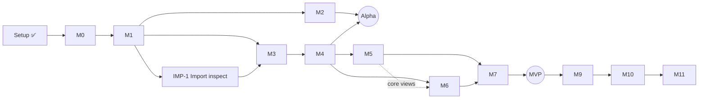
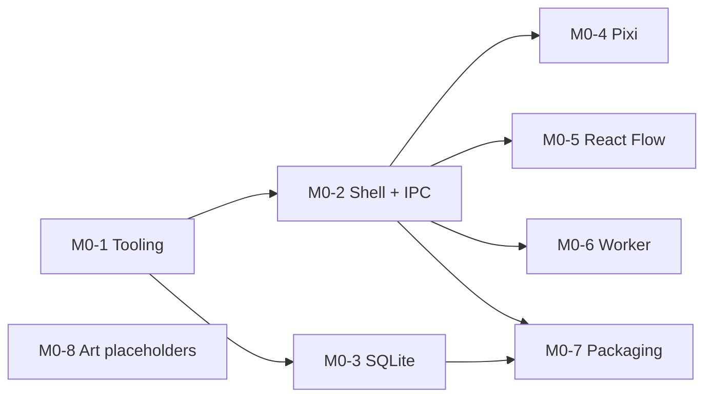

# Dependency graph & parallel lanes

> **What is this?** A map of *what must finish before what can start*. Anything without an arrow between it is a candidate for parallel work (see [MULTI_AGENT_GUIDE.md](../process/MULTI_AGENT_GUIDE.md)). Mermaid diagrams render on GitHub.

## Milestone level

**Parallel opportunities between milestones**
| After | Can run in parallel | Watch out for |
|---|---|---|
| M1 | M2 (world/canvas) ∥ M3 (resources/broker) ∥ IMP-1 | M2 and M3 both add DB migrations, so serialize migration numbering |
| M4 | M5 (experience) ∥ M6 (scheduler core) | M6 UI needs M5 project tabs. Do M6 backend first. |
| Any time | Art (ART_BIBLE, placeholders, later PixelLab batches) | Assets need the manifest format from M0-8 |
| M3+ | Provider adapters (OpenAI, Anthropic) behind the contract | Contract must be frozen first (M4) |

## Task level: M0

| Issue | Task | Depends on | Lane | Parallel-safe | Files owned |
|---|---|---|---|---|---|
| M0-1 ([#4](https://github.com/jash-aeio/AtlasRealm/issues/4)) | Tooling scaffold (pnpm, TS strict, ESLint/Prettier, Vitest, real CI) | — | — | ❌ goes first | root config, `.github/workflows` |
| M0-2 ([#5](https://github.com/jash-aeio/AtlasRealm/issues/5)) | Electron + React + Vite shell, minimal preload, typed IPC round-trip | M0-1 | A | ✅ | `src/main/bootstrap`, `src/preload`, `src/renderer/app`, `src/common/contracts` |
| M0-3 ([#6](https://github.com/jash-aeio/AtlasRealm/issues/6)) | SQLite binding + migration runner + persistence test | M0-1 | B | ✅ | `src/main/storage` |
| M0-4 ([#7](https://github.com/jash-aeio/AtlasRealm/issues/7)) | PixiJS placeholder canvas | M0-2 (renderer exists) | C | ✅ | `src/renderer/world` |
| M0-5 ([#8](https://github.com/jash-aeio/AtlasRealm/issues/8)) | React Flow selection-sharing spike | M0-2 | C | ✅ | `src/renderer/atlas` |
| M0-6 ([#9](https://github.com/jash-aeio/AtlasRealm/issues/9)) | Worker messaging spike | M0-2 | A | ✅ | `src/worker` |
| M0-7 ([#10](https://github.com/jash-aeio/AtlasRealm/issues/10)) | Windows packaging + smoke test | M0-2, M0-3 | — | ❌ integrator | packaging config |
| M0-8 ([#11](https://github.com/jash-aeio/AtlasRealm/issues/11)) | Minimal ART_BIBLE values + placeholder sprites + asset manifest | — | D | ✅ any time | `resources/assets`, `docs/art` |

> Note: M0-4/M0-5 depend on M0-2 only because they need a renderer to mount into. If M0-2 lands its app skeleton early, C can start right away.

## Updating this file
`/plan-milestone Mx` adds a task table and graph for each new milestone. Keep **Files owned** accurate. It's what makes parallel work safe.
