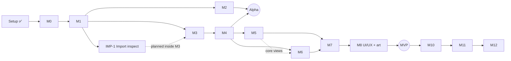
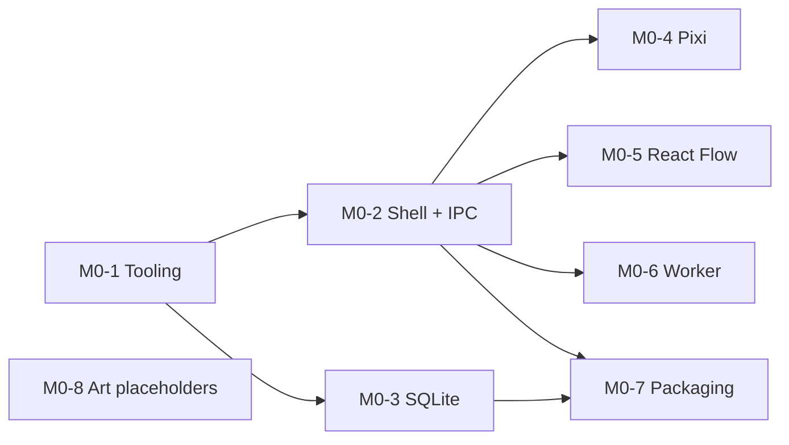
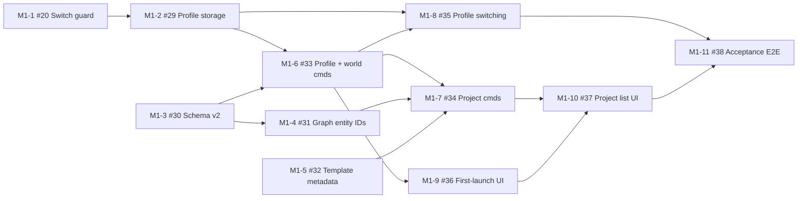
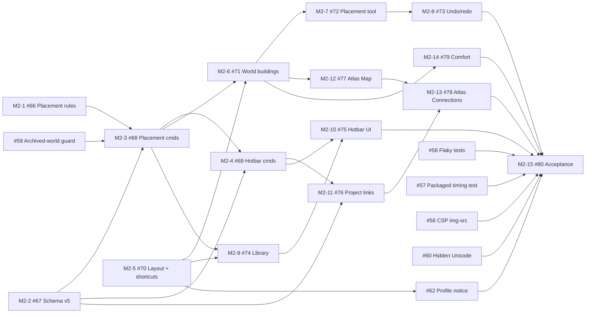

# Dependency graph & parallel lanes

> **What is this?** A map of *what must finish before what can start*. Anything without an arrow between it is a candidate for parallel work (see [MULTI_AGENT_GUIDE.md](../process/MULTI_AGENT_GUIDE.md)). Mermaid diagrams render on GitHub.

## Milestone level

**Parallel opportunities between milestones**
| After | Can run in parallel | Watch out for |
|---|---|---|
| M1 | M2 (world/canvas) ∥ M3 (resources/broker); IMP-1 is planned inside M3 | M2 and M3 both add DB migrations, so serialize migration numbering |
| M4 | M5 (experience) ∥ M6 (scheduler core) | M6 UI needs M5 project tabs. Do M6 backend first. |
| Any time | Art (ART_BIBLE, placeholders, later PixelLab batches) | Assets need the manifest format from M0-8 |
| M3+ | Provider adapters (OpenAI, Anthropic) behind the contract | Contract must be frozen first (M4) |

## Task level: M0

| Issue | Task | Depends on | Lane | Parallel-safe | Files owned |
|---|---|---|---|---|---|
| M0-1 ([#4](https://github.com/jash-aeio/AtlasRealm/issues/4)) | Tooling scaffold (pnpm, TS strict, ESLint/Prettier, Vitest, real CI) | — | — | ❌ goes first | root config, `.github/workflows` |
| M0-2 ([#5](https://github.com/jash-aeio/AtlasRealm/issues/5)) | Electron + React + Vite shell, minimal preload, typed IPC round-trip | M0-1 | A | ✅ | `src/main/bootstrap`, `src/preload`, `src/renderer/app`, `src/common/contracts` |
| M0-3 ([#6](https://github.com/jash-aeio/AtlasRealm/issues/6)) | SQLite binding + migration runner + persistence test | M0-1 | B | ✅ | `src/main/storage` |
| M0-4 ([#7](https://github.com/jash-aeio/AtlasRealm/issues/7)) | PixiJS placeholder canvas | M0-2 (renderer exists) | C | ✅ | `src/renderer/world` |
| M0-5 ([#8](https://github.com/jash-aeio/AtlasRealm/issues/8)) | React Flow selection-sharing spike | M0-2 | C | ✅ | `src/renderer/atlas` |
| M0-6 ([#9](https://github.com/jash-aeio/AtlasRealm/issues/9)) | Worker messaging spike | M0-2 | A | ✅ | `src/worker` |
| M0-7 ([#10](https://github.com/jash-aeio/AtlasRealm/issues/10)) | Windows packaging + smoke test | M0-2, M0-3 | — | ❌ integrator | packaging config |
| M0-8 ([#11](https://github.com/jash-aeio/AtlasRealm/issues/11)) | Minimal ART_BIBLE values + placeholder sprites + asset manifest | — | D | ✅ any time | `resources/assets`, `docs/art` |

> Note: M0-4/M0-5 depend on M0-2 only because they need a renderer to mount into. If M0-2 lands its app skeleton early, C can start right away.

## Task level: M1

| Issue | Task | Depends on | Lane | Parallel-safe | Files owned |
|---|---|---|---|---|---|
| M1-1 ([#20](https://github.com/jash-aeio/AtlasRealm/issues/20)) | Block Chromium debug and security switches | — | A | ✅ | `src/main/index.ts` (early guard), `electron-builder.yml`, `tests/e2e-packaged` |
| M1-2 ([#29](https://github.com/jash-aeio/AtlasRealm/issues/29)) | Profile storage (index, folders, adopt M0 default) | M1-1 | A | ❌ | `src/main/storage/profiles/*`, `src/main/storage/app-database.ts`, `src/main/index.ts` |
| M1-3 ([#30](https://github.com/jash-aeio/AtlasRealm/issues/30)) | Schema v2 + repositories | — | B | ✅ (migration) | `src/main/storage/migrations/index.ts`, `src/main/storage/repositories/{profile-settings,world,project}-repository.ts`, `tests/fixtures/db` |
| M1-4 ([#31](https://github.com/jash-aeio/AtlasRealm/issues/31)) | Graph entity IDs + ownership | M1-3 | B | ✅ (migration, after M1-3) | `src/main/storage/migrations/index.ts`, `src/main/storage/repositories/graph-entity-repository.ts` |
| M1-5 ([#32](https://github.com/jash-aeio/AtlasRealm/issues/32)) | Project template metadata | — | C | ✅ | `resources/project-templates/**`, `src/common/contracts/project-template.ts`, `src/main/templates/*` |
| M1-6 ([#33](https://github.com/jash-aeio/AtlasRealm/issues/33)) | Profile + world commands | M1-2, M1-3 | A | ❌ shared preload/channels | `src/main/ipc/commands/{profile,world}*`, `src/common/contracts/{profile,world}.ts`, `channels.ts`, `atlas-api.ts`, `src/preload/index.ts` |
| M1-7 ([#34](https://github.com/jash-aeio/AtlasRealm/issues/34)) | Project commands | M1-3, M1-4, M1-5, M1-6 | B | ❌ shared preload/channels | `src/main/services/project-service.ts`, `src/main/ipc/commands/project*`, `src/common/contracts/project.ts` |
| M1-8 ([#35](https://github.com/jash-aeio/AtlasRealm/issues/35)) | Profile switching | M1-2, M1-6 | A | ❌ | `src/main/services/profile-session.ts`, `src/main/runtime-bridge/*` |
| M1-9 ([#36](https://github.com/jash-aeio/AtlasRealm/issues/36)) | First-launch UI | M1-6 | C | ❌ | `src/renderer/app/*`, `src/renderer/onboarding/*`, `src/renderer/state/*` |
| M1-10 ([#37](https://github.com/jash-aeio/AtlasRealm/issues/37)) | Project list UI | M1-7, M1-9 | C | ❌ | `src/renderer/projects/*` |
| M1-11 ([#38](https://github.com/jash-aeio/AtlasRealm/issues/38)) | Acceptance E2E + packaged smoke | M1-8, M1-10 | — | ❌ integrator | `tests/e2e/m1-*.spec.ts`, `tests/e2e-packaged/*` |

**Critical path:** M1-1 → M1-2 → M1-6 → M1-7 → M1-10 → M1-11.
**Parallel lanes at the start:** A = M1-1 → M1-2 · B = M1-3 → M1-4 · C = M1-5. From M1-6 on, the command tasks share `channels.ts`, `atlas-api.ts` and the preload, so they run one after another. M1-8 (lane A) and M1-9 (lane C) can overlap once M1-6 lands.
> Migration numbering: M1-3 owns migration 2 and M1-4 owns migration 3. No other M1 task adds a migration.

## Task level: M2

| Issue | Task | Depends on | Lane | Parallel-safe | Files owned |
|---|---|---|---|---|---|
| M2-1 ([#66](https://github.com/jash-aeio/AtlasRealm/issues/66)) | Placement rules | — | C | ✅ | `src/common/world/placement-rules.ts`, `tests/domain/placement-rules.test.ts` |
| M2-2 ([#67](https://github.com/jash-aeio/AtlasRealm/issues/67)) | Schema v5: placements + hotbar | — | A | ✅ (migration 5) | `src/main/storage/migrations/index.ts`, `src/main/storage/repositories/{placement,hotbar}-repository.ts`, `tests/fixtures/db` |
| M2-3 ([#68](https://github.com/jash-aeio/AtlasRealm/issues/68)) | Placement commands | M2-1, M2-2, #59 | A | ❌ shared preload/channels | `src/main/services/placement-service.ts`, `src/main/ipc/commands/placement.ts`, `src/common/contracts/placement.ts`, `project-service.ts` (archive/trash hook) |
| M2-4 ([#69](https://github.com/jash-aeio/AtlasRealm/issues/69)) | Hotbar commands | M2-2, M2-3 | A | ❌ shared preload/channels | `src/main/services/hotbar-service.ts`, `src/main/ipc/commands/hotbar.ts`, `src/common/contracts/hotbar.ts` |
| M2-5 ([#70](https://github.com/jash-aeio/AtlasRealm/issues/70)) | Main layout + shortcut layer + sidebar | — | B | ✅ | `src/renderer/app/*`, `tests/e2e/shell.spec.ts` |
| M2-6 ([#71](https://github.com/jash-aeio/AtlasRealm/issues/71)) | World shows real buildings | M2-3, M2-5 | B | ❌ | `src/renderer/world/*`, `src/renderer/state/selection.ts`, `tests/e2e/world.spec.ts` |
| M2-7 ([#72](https://github.com/jash-aeio/AtlasRealm/issues/72)) | Placement tool | M2-6 | B | ❌ | `src/renderer/world/placement-tool.ts`, `src/renderer/projects/ProjectItem.tsx`, `tests/e2e/placement.spec.ts` |
| M2-8 ([#73](https://github.com/jash-aeio/AtlasRealm/issues/73)) | Placement undo/redo | M2-7 | B | ❌ | `src/renderer/world/placement-history.ts`, `tests/domain/placement-history.test.ts` |
| M2-9 ([#74](https://github.com/jash-aeio/AtlasRealm/issues/74)) | Library panel (E) | M2-3, M2-5 | C | ❌ | `src/renderer/library/*`, `src/renderer/projects/*` (filters), `tests/e2e/library.spec.ts` |
| M2-10 ([#75](https://github.com/jash-aeio/AtlasRealm/issues/75)) | Hotbar UI | M2-4, M2-9 | C | ❌ | `src/renderer/hotbar/*`, `tests/e2e/hotbar.spec.ts` |
| M2-11 ([#76](https://github.com/jash-aeio/AtlasRealm/issues/76)) | Project links + bounded graph query | M2-2, M2-4 | A | ❌ shared preload/channels | migration 6, `src/main/services/graph-service.ts`, `src/main/ipc/commands/{relation,graph}.ts`, `src/common/contracts/{relation,graph}.ts` |
| M2-12 ([#77](https://github.com/jash-aeio/AtlasRealm/issues/77)) | Atlas shell + Map tab | M2-6 | C | ❌ | `src/renderer/atlas/RealmAtlasPanel.tsx`, `src/renderer/atlas/MapTab.tsx`, `tests/e2e/atlas.spec.ts` |
| M2-13 ([#78](https://github.com/jash-aeio/AtlasRealm/issues/78)) | Atlas Connections | M2-11, M2-12 | C | ❌ | `src/renderer/atlas/{ConnectionsGraph,ConnectionsList,LinkForm}.tsx` |
| M2-14 ([#79](https://github.com/jash-aeio/AtlasRealm/issues/79)) | Comfort settings | M2-6 | B | ❌ | `src/renderer/world/comfort.ts`, `SettingsView.tsx` (comfort section) |
| M2-15 ([#80](https://github.com/jash-aeio/AtlasRealm/issues/80)) | Acceptance E2E + packaged smoke | all | — | ❌ integrator | `tests/e2e/m2-acceptance.spec.ts`, `tests/e2e-packaged/*` |
| [#56](https://github.com/jash-aeio/AtlasRealm/issues/56) | Fix flaky timing tests + IPC payload gate | — | D | ✅ | `tests/integration/{ipc-router,worker-messaging}.test.ts`, `src/main/ipc/router.ts`, `src/common/contracts/json-size.ts` (any later task touching these two goes after #56) |
| [#57](https://github.com/jash-aeio/AtlasRealm/issues/57) | Packaged offline resource-timing test | — | D | ✅ | `tests/e2e-packaged/packaged.spec.ts` |
| [#58](https://github.com/jash-aeio/AtlasRealm/issues/58) | CSP: drop `data:` from `img-src` | — | D | ✅ | `src/common/security/csp.ts` |
| [#59](https://github.com/jash-aeio/AtlasRealm/issues/59) | Archived-world guard (F5) | — | D | ❌ before M2-3 | `src/main/services/project-service.ts` |
| [#60](https://github.com/jash-aeio/AtlasRealm/issues/60) | Hidden Unicode in names/goals | — | D | ✅ | `src/common/contracts/{display-name,world,project}.ts`, `repository-support.ts` |
| [#62](https://github.com/jash-aeio/AtlasRealm/issues/62) | Profile security notice | M2-5 | D | ❌ | `src/renderer/app/SettingsView.tsx` |

**Critical path:** M2-2 → M2-3 → M2-6 → M2-7 → M2-8 → M2-15. A second path of the same length: M2-3 → M2-4 → M2-11 → M2-13 → M2-15.
**Parallel lanes at the start (max 3):** A = M2-2 (schema), with #59 first or alongside it · B = M2-5 (layout) · C = M2-1 (rules). Lane D follow-ups (#56 already in progress, #57, #58, #60) are small and parallel-safe, so they fill gaps. M2-3, M2-4 and M2-11 share `channels.ts`, `atlas-api.ts` and the preload, so they run one after another. Once M2-6 lands, B (M2-7 → M2-8, M2-14) and C (M2-12, M2-9 → M2-10) can overlap.
> Migration numbering: M2-2 owns migration 5 and M2-11 owns migration 6. No other M2 task adds a migration. If M3 work starts in parallel, it takes migration 7 or later.

## Updating this file
`/plan-milestone Mx` adds a task table and graph for each new milestone. Keep **Files owned** accurate. It's what makes parallel work safe.
