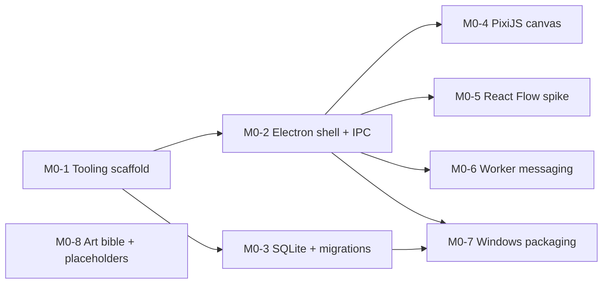

# Multi-agent development guide

Several Claude agents can work **at the same time** on independent tasks. This guide explains when that's safe and how we do it.

## Concepts (learning)
- **Subagent:** a helper Claude with its *own* context window. The main session gives it a task and gets back a summary. It's good for reviews and research because it keeps the main conversation small.
- **Git worktree:** a second (third, …) checkout of the same repo in another folder, on a different branch. Two agents editing in two worktrees can't overwrite each other's files.
- **Integrator:** the main session, which merges the lanes back together in a safe order and re-runs the tests.
- **Lane:** a chain of tasks that one agent works through in order.

## When is a task parallel-safe?
All of these must hold:
1. **No dependency** between the tasks (check `docs/pm/DEPENDENCIES.md`).
2. **Disjoint files:** they don't edit the same files. Shared contracts (`src/common/contracts/`) must be written *first*, by one agent.
3. **No shared migrations:** two tasks adding database migrations at the same time cause numbering conflicts. Serialize them.
4. **Each task can be verified on its own.**

Issues meeting these get the `parallel-safe` label.

## How to run it
```
/parallel-run
```
The skill will:
1. Read the dependency graph and open issues and find the **ready** tasks (dependencies merged).
2. Group them into lanes with disjoint file ownership.
3. **Ask you to confirm** the lanes. Agents cost usage, so you decide.
4. Start one subagent per lane with `isolation: worktree`. Each works on its own branch.
5. Merge in dependency order, run the full test suite after each merge, and open PRs.

You can also do it by hand: open separate terminals and run `claude --worktree <name>` in each.

## Limits we keep
- **At most 3 parallel lanes** (the same spirit as the spec's three-agent limit). More lanes mean more merge pain and more cost.
- Spikes and docs work are the easiest to parallelize. Core architecture (IPC contracts, DB schema) runs serially.
- If two lanes start touching the same file, stop one lane and serialize.

## Example: M0

After M0-1 merges, **B (shell)** and **C (SQLite)** run in parallel. Once B's renderer skeleton exists, **D+E** (each in its own renderer folder) and **F** can fan out too. M0-8 can run at any time. M0-7 waits for B and C.

## Lessons to watch for
After each parallel run, add a note to the session log: what conflicted, what went smoothly, and whether parallel was actually faster than serial. That evidence is the real learning.
